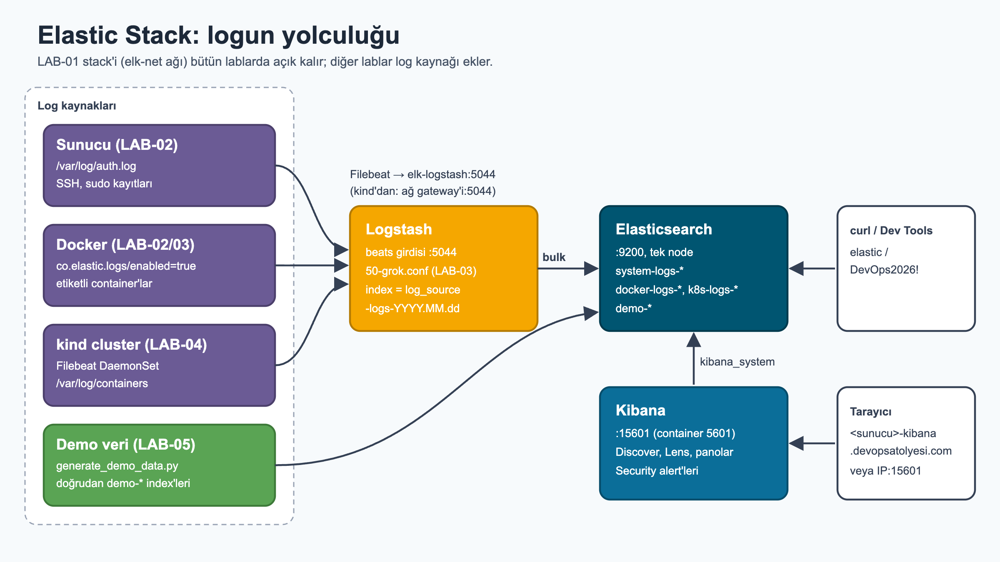
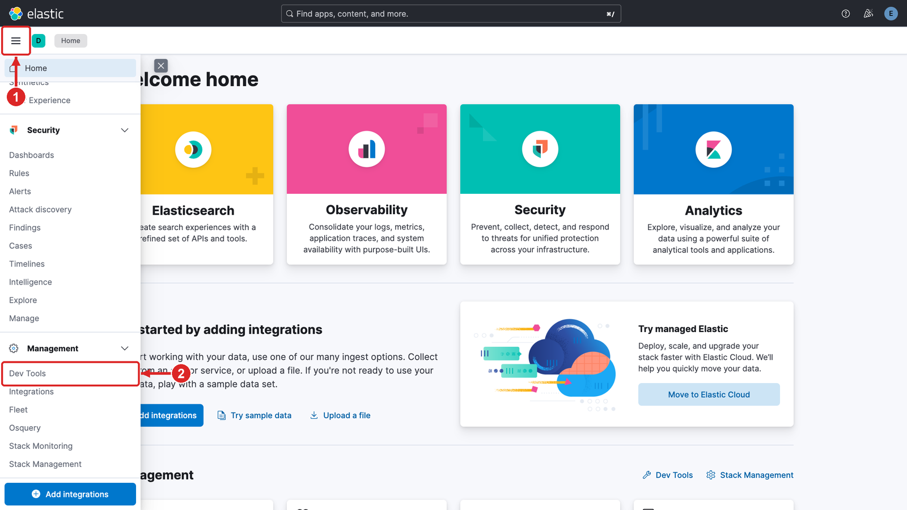
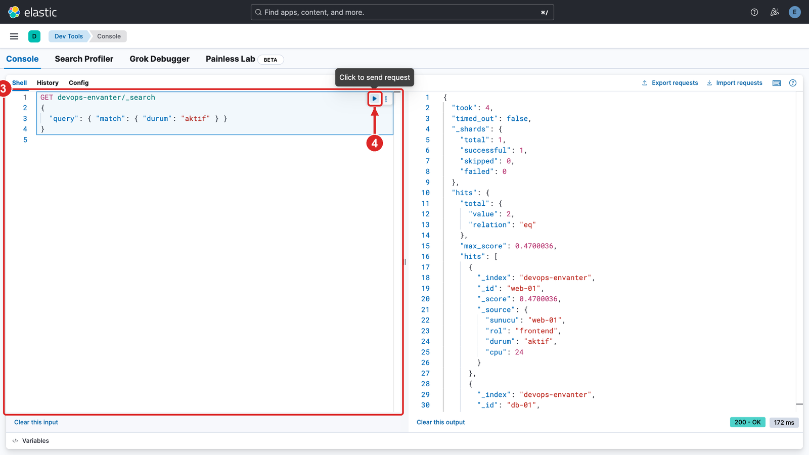

# LAB-ELK-01 — Elastic Stack Kurulumu ve İlk Belgeler

| Profil / Araçlar | Açık Portlar |
|---|---|
| `docker compose`, Elasticsearch 8.19, Kibana 8.19, Logstash 8.19 | 9200 (Elasticsearch), 15601 (Kibana), 5044 (Logstash Beats) |

## Amaç

- Elasticsearch, Kibana ve Logstash'i Docker Compose ile kurmak.
- `curl` ile index oluşturmak, belge eklemek, aramak ve silmek.
- Aynı işlemleri Kibana Dev Tools ekranından yapmak.

## Ön Koşullar

- Sunucuda `docker`, `docker compose`, `curl` ve `jq` olmalıdır.
- `9200`, `15601` ve `5044` portları boş olmalıdır.
- Bu stack sonraki bütün labların ortak altyapısıdır; LAB-07 bitene kadar kapatmayın.

## Mimari ve Çalışma Modeli

{width=60%}

- **Elasticsearch** veriyi saklar ve arar. Tek node çalışır, güvenlik açıktır (`elastic` kullanıcısı).
- **Kibana** web arayüzüdür. Elasticsearch'e `kibana_system` kullanıcısıyla bağlanır; bu kullanıcının parolasını `kibana-setup` container'ı verip kapanır.
- **Logstash** Filebeat'lerden `5044` portundan log alır ve Elasticsearch'e yazar. Pipeline dosyaları `pipeline/` klasöründedir.

<details>
<summary><strong>Compose ve pipeline dosyalarındaki önemli satırlar</strong></summary>

| Satır | Ne işe yarar |
|---|---|
| `discovery.type=single-node` | Tek node'lu cluster; başka node aramaz. |
| `ELASTIC_PASSWORD=${ELASTIC_PASSWORD:-DevOps2026!}` | `elastic` kullanıcısının parolası. `.env` dosyası yoksa varsayılan kullanılır. |
| `es-data` volume | Container silinse de veri kalır. `docker compose down -v` ile silinir. |
| `"15601:5601"` | Kibana container içinde 5601'de, sunucuda 15601'de yayınlanır. |
| `CONFIG_RELOAD_AUTOMATIC=true` | `pipeline/` klasöründeki değişiklik Logstash yeniden başlatılmadan yüklenir (LAB-03). |
| `networks: default: name: elk-net` | Sonraki labların container'ları bu ağa katılıp `elk-logstash` adıyla bağlanır. |
| `index => "%{[fields][log_source]}-logs-%{+YYYY.MM.dd}"` | Filebeat'in eklediği `log_source` alanına göre `system-logs-…`, `docker-logs-…`, `k8s-logs-…` index'leri oluşur. |

</details>

## Adım Adım Uygulama Rehberi

### 1. Stack'i başlatma

```bash
cd ~/elk-lab/01-elk-stack-setup
```

Elasticsearch, `vm.max_map_count` değerinin en az `262144` olmasını ister. Değer düşükse yükseltin:

```bash
[ "$(sysctl -n vm.max_map_count)" -ge 262144 ] || sudo sysctl -w vm.max_map_count=262144
sysctl vm.max_map_count
```

Stack'i başlatın. İlk açılışta image'lar indirilir; Elasticsearch sağlıklı olunca Kibana ve Logstash başlar:

```bash
docker compose up -d
```

```bash
docker compose ps -a --format "table {{.Name}}\t{{.Status}}"
```

```text
NAME                STATUS
elk-elasticsearch   Up About a minute (healthy)
elk-kibana          Up 9 seconds
elk-kibana-setup    Exited (0) 9 seconds ago
elk-logstash        Up 10 seconds
```

`elk-kibana-setup` işini yapıp kapanır; `Exited (0)` doğru durumdur.

### 2. Elasticsearch'e bağlanma

```bash
curl -s -u elastic:'DevOps2026!' http://localhost:9200 | jq '{name, version: .version.number}'
```

```bash
curl -s -u elastic:'DevOps2026!' "http://localhost:9200/_cluster/health?filter_path=status,number_of_nodes"
```

`status` değeri `green` ya da `yellow` olabilir. `yellow` tek node'lu cluster'da normaldir; nedeni LAB-07'de.

### 3. Belge ekleme, arama ve silme

Bir sunucu envanteri belgesi ekleyin. `devops-envanter` index'i yoksa otomatik oluşur:

```bash
curl -s -u elastic:'DevOps2026!' -X POST "http://localhost:9200/devops-envanter/_doc/web-01?refresh=true" \
  -H "Content-Type: application/json" \
  -d '{"sunucu": "web-01", "rol": "frontend", "durum": "aktif", "cpu": 24}' | jq '{_index, _id, result}'
```

İkinci belge:

```bash
curl -s -u elastic:'DevOps2026!' -X POST "http://localhost:9200/devops-envanter/_doc/db-01?refresh=true" \
  -H "Content-Type: application/json" \
  -d '{"sunucu": "db-01", "rol": "database", "durum": "bakimda", "cpu": 71}' | jq '{_index, _id, result}'
```

`rol` alanı `frontend` olan belgeleri arayın:

```bash
curl -s -u elastic:'DevOps2026!' "http://localhost:9200/devops-envanter/_search?filter_path=hits.hits._source" \
  -H "Content-Type: application/json" \
  -d '{"query": {"match": {"rol": "frontend"}}}' | jq -c '.hits.hits[]._source'
```

```text
{"sunucu":"web-01","rol":"frontend","durum":"aktif","cpu":24}
```

CPU kullanımı 50'nin üstünde olanlar:

```bash
curl -s -u elastic:'DevOps2026!' "http://localhost:9200/devops-envanter/_search?filter_path=hits.hits._source" \
  -H "Content-Type: application/json" \
  -d '{"query": {"range": {"cpu": {"gt": 50}}}}' | jq -c '.hits.hits[]._source'
```

```text
{"sunucu":"db-01","rol":"database","durum":"bakimda","cpu":71}
```

Bir belgeyi güncelleyin ve tekrar okuyun:

```bash
curl -s -u elastic:'DevOps2026!' -X POST "http://localhost:9200/devops-envanter/_update/db-01?refresh=true" \
  -H "Content-Type: application/json" -d '{"doc": {"durum": "aktif"}}' | jq -r .result
curl -s -u elastic:'DevOps2026!' "http://localhost:9200/devops-envanter/_doc/db-01" | jq -c ._source
```

```text
updated
{"sunucu":"db-01","rol":"database","durum":"aktif","cpu":71}
```

### 4. Kibana'ya giriş

Tarayıcıda açılacak adres:

```bash
echo "https://$(hostname)-kibana.devopsatolyesi.com"
```

Alan adı yoksa sunucu IP'si ve portuyla da açılır (firewall'da `15601` açık olmalıdır):

```bash
echo "http://$(curl -s ifconfig.me):15601"
```

Kullanıcı `elastic`, parola `DevOps2026!`. İlk girişte çıkan **Welcome to Elastic** ekranında **Explore on my own**'a tıklayın.

### 5. Kibana Dev Tools ile aynı işlemler

1. Sol üstteki menü düğmesine tıklayın.
2. Menünün altında **Management > Dev Tools**'a tıklayın. İlk açılışta çıkan tanıtım penceresini **Skip tour** ile kapatın.

   {width=75%}

3. Sol paneldeki örnek metni silin (**Clear this input**) ve aşağıdaki isteği yapıştırın.
4. İmleci isteğin ilk satırına getirip sağdaki ▶ (**Click to send request**) düğmesine basın. Yanıt sağ panelde görünür.

   {width=75%}

```http
GET devops-envanter/_search
{
  "query": { "match": { "durum": "aktif" } }
}
```

```http
GET _cat/indices/devops-*?v
```

Dev Tools aynı REST API'yi kullanır; `curl` ile yaptığınız her isteği burada adres ve gövde olarak yazabilirsiniz.

### 6. Index'i silme

```bash
curl -s -u elastic:'DevOps2026!' -X DELETE "http://localhost:9200/devops-envanter" | jq -c .
```

```text
{"acknowledged":true}
```

## Temizlik

Stack sonraki labların altyapısıdır; **bütün lablar bitince** kapatın. `-v` Elasticsearch verisini de siler:

```bash
cd ~/elk-lab/01-elk-stack-setup
docker compose down -v
```

Sonraki lab: **[LAB-ELK-02 — Filebeat ile Linux ve Docker Logları](../02-filebeat-host-docker/README.md)**
