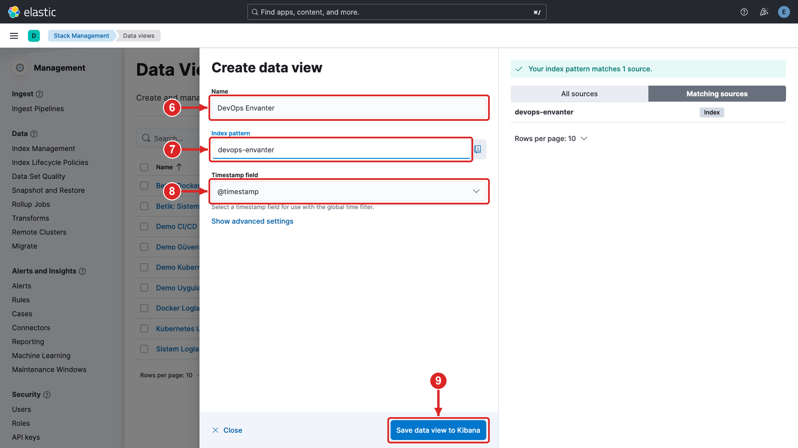
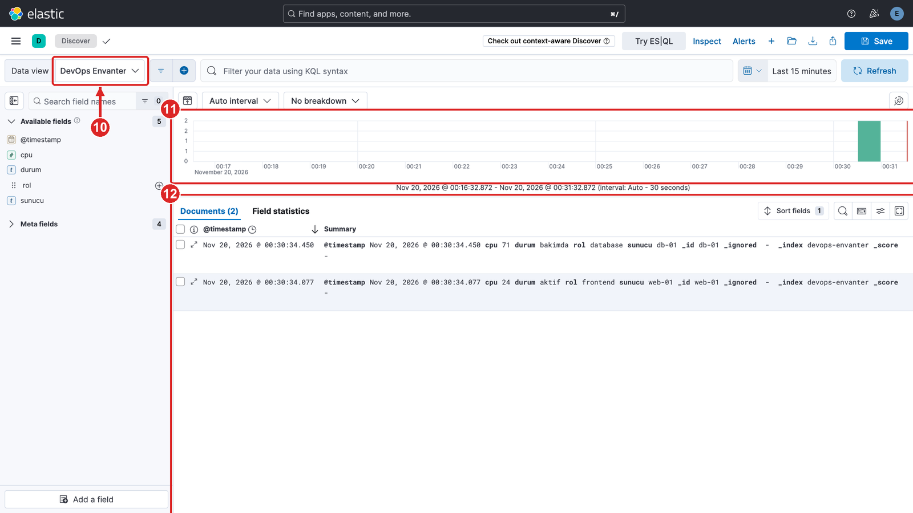

# LAB-ELK-01 — Elastic Stack Kurulumu ve İlk Belgeler

| Profil / Araçlar | Açık Portlar |
|---|---|
| `docker compose`, Elasticsearch 8.19, Kibana 8.19, Logstash 8.19 | 9200 (Elasticsearch), 15601 (Kibana), 5044 (Logstash Beats) |

## Amaç

- Elasticsearch, Kibana ve Logstash'i Docker Compose ile kurmak.
- Kibana Dev Tools'ta belge eklemek, aramak ve güncellemek.
- Belgeleri Discover'da görmek ve zaman alanının (`@timestamp`) neden gerekli olduğunu görmek.

## Ön Koşullar

- Sunucuda `docker`, `docker compose`, `curl` ve `jq` olmalıdır.
- `9200`, `15601` ve `5044` portları boş olmalıdır.
- Bu stack sonraki bütün labların ortak altyapısıdır; LAB-07 bitene kadar kapatmayın.

## Mimari ve Çalışma Modeli

{width=60%}

- **Elasticsearch** veriyi saklar ve arar. Tek node çalışır, güvenlik açıktır (`elastic` kullanıcısı).
- **Kibana** web arayüzüdür. Elasticsearch'e `kibana_system` kullanıcısıyla bağlanır; bu kullanıcının parolasını `kibana-setup` container'ı verip kapanır.
- **Logstash** Filebeat'lerden `5044` portundan log alır ve Elasticsearch'e yazar. Pipeline dosyaları `pipeline/` klasöründedir.

<details>
<summary><strong>Compose ve pipeline dosyalarındaki önemli satırlar</strong></summary>

| Satır | Ne işe yarar |
|---|---|
| `discovery.type=single-node` | Tek node'lu cluster; başka node aramaz. |
| `ELASTIC_PASSWORD=${ELASTIC_PASSWORD:-DevOps2026!}` | `elastic` kullanıcısının parolası. `.env` dosyası yoksa varsayılan kullanılır. |
| `es-data` volume | Container silinse de veri kalır. `docker compose down -v` ile silinir. |
| `"15601:5601"` | Kibana container içinde 5601'de, sunucuda 15601'de yayınlanır. |
| `CONFIG_RELOAD_AUTOMATIC=true` | `pipeline/` klasöründeki değişiklik Logstash yeniden başlatılmadan yüklenir; pipeline'a yeni filtre eklemek için Logstash'i kapatmak gerekmez. |
| `networks: default: name: elk-net` | Sonraki labların container'ları bu ağa katılıp `elk-logstash` adıyla bağlanır. |
| `index => "%{[fields][log_source]}-logs-%{+YYYY.MM.dd}"` | Filebeat'in eklediği `log_source` alanına göre `system-logs-…`, `docker-logs-…`, `k8s-logs-…` index'leri oluşur. |

</details>

## Adım Adım Uygulama Rehberi

### 1. Stack'i başlatma

```bash
cd ~/elk-lab/01-elk-stack-setup
```

Elasticsearch, index dosyalarını diskten okurken **mmap** (memory-mapped file) kullanır: dosyayı belleğe eşler, böylece işletim sistemi sık okunan kısımları RAM'de tutar ve arama hızlanır. Her index çok sayıda dosyadan oluştuğu için çok sayıda eşleme açılır. Linux bir sürecin açabileceği eşleme sayısını `vm.max_map_count` ile sınırlar; varsayılan değer `65530`'dur. Elasticsearch açılışta bu değerin en az `262144` olduğunu kontrol eder. Daha düşükse `max virtual memory areas vm.max_map_count [65530] is too low` hatasıyla kapanır ve container sürekli yeniden başlar.

Komut, değer zaten yeterliyse hiçbir şey yapmaz; düşükse `262144`'e yükseltir. `sysctl -w` ile verilen değer sunucu yeniden başlayana kadar geçerlidir:

```bash
[ "$(sysctl -n vm.max_map_count)" -ge 262144 ] || sudo sysctl -w vm.max_map_count=262144
sysctl vm.max_map_count
```

Stack'i başlatın. İlk açılışta dört image indirilir (yaklaşık 2 GB). Compose servisleri `depends_on` sırasıyla açar:

1. **elasticsearch** başlar. Healthcheck her 10 saniyede `_cluster/health` adresini sorgular; cevap gelince `healthy` olur.
2. Elasticsearch `healthy` olunca **logstash** ve **kibana-setup** başlar.
3. **kibana-setup** işini bitirip `0` koduyla kapanınca **kibana** başlar.

Komut, Elasticsearch `healthy` olana kadar bekler; bu 1-2 dakika sürebilir:

```bash
docker compose up -d
```

```bash
docker compose ps -a --format "table {{.Name}}\t{{.Status}}"
```

```text
NAME                STATUS
elk-elasticsearch   Up About a minute (healthy)
elk-kibana          Up 9 seconds
elk-kibana-setup    Exited (0) 9 seconds ago
elk-logstash        Up 10 seconds
```

**`elk-kibana-setup` neden var ve neden kapanıyor?** Kibana, Elasticsearch'e bağlanırken `elastic` süper kullanıcısını kullanamaz; Elasticsearch 8 buna izin vermez. Kibana için hazır gelen `kibana_system` kullanıcısı kullanılır, ama bu kullanıcının ilk kurulumda parolası yoktur. `kibana-setup`, Elasticsearch API'sine (`_security/user/kibana_system/_password`) bir istek atıp bu kullanıcıya `.env` dosyasındaki ya da varsayılan parolayı verir ve işi bittiği için kapanır.

- `Exited (0)`: parola verildi, Kibana bu parolayla bağlanıyor. Doğru durum budur.
- `Exited (1)` ya da başka bir kod: parola verilemedi. Kibana açılmaz ve `docker logs elk-kibana` çıktısında kimlik doğrulama hatası görünür. Önce `docker logs elk-kibana-setup` ile nedenine bakın.

`elk-kibana` ve `elk-logstash` için `Up` görmek yeterlidir. Kibana'nın arayüzü açılması, `Up` olduktan sonra 30-60 saniye daha sürer.

### 2. Elasticsearch'e bağlanma

```bash
curl -s -u elastic:'DevOps2026!' http://localhost:9200 | jq '{name, version: .version.number}'
```

```bash
curl -s -u elastic:'DevOps2026!' "http://localhost:9200/_cluster/health?filter_path=status,number_of_nodes"
```

İlk komut Elasticsearch'in çalıştığını ve sürümünü gösterir. `-u elastic:'DevOps2026!'` kullanıcı adı ve parolayı gönderir; güvenlik açık olduğu için parolasız istek `401` ile reddedilir.

İkinci komut cluster sağlığını gösterir. `status` şunlardan biridir:

- `green`: bütün shard'lar yerinde.
- `yellow`: veri tam, ama bazı replica shard'lar atanamamış. Elasticsearch her index'i parçalara (**shard**) böler ve her shard'ın bir yedeğini (**replica**) tutar. Yedek, asıl shard'la aynı node'a konmaz; o node çökerse yedek de giderdi. Tek node'lu cluster'da yedeği koyacak ikinci node olmadığı için replica'lar atanmadan bekler ve durum `yellow` görünür. Veri kaybı yoktur; bu lab ortamında normaldir.
- `red`: bazı verilere erişilemiyor; bu durumda devam etmeyin.

### 3. Kibana'ya giriş

Tarayıcıda açılacak adres:

```bash
echo "https://$(hostname)-kibana.devopsatolyesi.com"
```

Alan adı yoksa sunucu IP'si ve portuyla da açılır (firewall'da `15601` açık olmalıdır):

```bash
echo "http://$(curl -s ifconfig.me):15601"
```

Kullanıcı `elastic`, parola `DevOps2026!`. İlk girişte çıkan **Welcome to Elastic** ekranında **Explore on my own**'a tıklayın.

### 4. Dev Tools'u açma

**Dev Tools**, Kibana'daki Elasticsearch konsoludur: sol panele isteği yazarsınız, sağda yanıt görünür. `curl`'den farkı, adres ve parola yazmanız gerekmemesidir.

1. Sol üstteki menü düğmesine tıklayın.
2. Menünün altında **Management > Dev Tools**'a tıklayın. İlk açılışta çıkan tanıtım penceresini **Skip tour** ile kapatın.

   {width=75%}

3. Sol paneldeki örnek metni silin (**Clear this input**).

Bir istek, ilk satırda yöntem ve adres, altında JSON gövdeden oluşur. Çalıştırmak için imleci isteğe getirip ▶ düğmesine basın ya da `Ctrl+Enter` kullanın.

### 5. Belge ekleme, arama ve güncelleme

Elasticsearch'te veri **belge** (JSON nesnesi) olarak **index** içinde saklanır; index bir tabloya benzer. İstekleri sırayla yapıştırıp tek tek çalıştırın.

**Zaman damgası.** Kibana'nın zaman filtreleri ("son 15 dakika") ve grafikleri belgedeki `@timestamp` alanına göre çalışır. Zamanı elle yazmak yerine bir **ingest pipeline** ile Elasticsearch'e yazdırın; pipeline, belge kaydedilmeden önce çalışan işlem adımlarıdır. Bu pipeline her belgeye kaydedildiği anı ekler:

```http
PUT _ingest/pipeline/zaman-ekle
{
  "processors": [
    { "set": { "field": "@timestamp", "value": "{{_ingest.timestamp}}" } }
  ]
}
```

```text
{
  "acknowledged": true
}
```

**Belge ekleme.** Adresin parçaları:

- `devops-envanter/_doc/web-01`: index adı ve belge kimliği. Index yoksa ilk belgeyle oluşur; alan türleri (`cpu` sayı, `sunucu` metin) ilk değerlerden çıkarılır.
- `refresh=true`: belgeyi hemen aranabilir yapar (normalde ~1 saniye sonra açılır).
- `pipeline=zaman-ekle`: belgeye `@timestamp` ekler.
- `filter_path=...`: yanıtı kısaltır; tam yanıt için silebilirsiniz.

İsteği sol panele (3) yapıştırın ve ▶ düğmesine (4) basın; yanıt sağ panelde görünür:

```http
POST devops-envanter/_doc/web-01?refresh=true&pipeline=zaman-ekle&filter_path=_index,_id,result
{
  "sunucu": "web-01",
  "rol": "frontend",
  "durum": "aktif",
  "cpu": 24
}
```

```text
{
  "_index": "devops-envanter",
  "_id": "web-01",
  "result": "created"
}
```

{width=75%}

`created` belgenin yazıldığını söyler; aynı istek tekrar çalışırsa `updated` döner, belge üzerine yazılır.

İkinci belgeyi ekleyin:

```http
POST devops-envanter/_doc/db-01?refresh=true&pipeline=zaman-ekle&filter_path=_index,_id,result
{
  "sunucu": "db-01",
  "rol": "database",
  "durum": "bakimda",
  "cpu": 71
}
```

**Metin araması.** `match`, `rol` alanında `frontend` geçen belgeleri bulur:

```http
GET devops-envanter/_search?filter_path=hits.hits._source
{
  "query": { "match": { "rol": "frontend" } }
}
```

```text
{
  "hits": {
    "hits": [
      {
        "_source": {
          "sunucu": "web-01",
          "rol": "frontend",
          "durum": "aktif",
          "cpu": 24
        }
      }
    ]
  }
}
```

**Sayı aralığı.** `range` sayı alanlarında çalışır; `gt` büyüktür, `gte`, `lt`, `lte` de vardır. CPU'su 50'nin üstünde olanlar:

```http
GET devops-envanter/_search?filter_path=hits.hits._source
{
  "query": { "range": { "cpu": { "gt": 50 } } }
}
```

```text
{
  "hits": {
    "hits": [
      {
        "_source": {
          "sunucu": "db-01",
          "rol": "database",
          "durum": "bakimda",
          "cpu": 71
        }
      }
    ]
  }
}
```

**Güncelleme.** `_update` yalnız verilen alanı değiştirir, diğerleri korunur:

```http
POST devops-envanter/_update/db-01?refresh=true&filter_path=result
{
  "doc": { "durum": "aktif" }
}
```

```text
{
  "result": "updated"
}
```

Belgeyi kimliğiyle okuyun:

```http
GET devops-envanter/_doc/db-01?filter_path=_source
```

```text
{
  "_source": {
    "sunucu": "db-01",
    "rol": "database",
    "durum": "aktif",
    "cpu": 71
  }
}
```

**Index'leri listeleme.** `_cat` API'leri sonucu tablo olarak verir. `yellow`, replica'nın tek node'da atanamamasındandır (Adım 2):

```http
GET _cat/indices/devops-*?v&h=health,index,docs.count
```

```text
health index           docs.count
yellow devops-envanter          2
```

<details>
<summary><strong>Aynı işlemleri terminalden curl ile yapmak</strong></summary>

Her Dev Tools isteğinin `curl` karşılığı vardır; adres, parola (`-u`) ve JSON başlığı elle verilir. Betiklerde bu yol kullanılır.

```text
curl -s -u elastic:'DevOps2026!' -X POST "http://localhost:9200/devops-envanter/_doc/web-01?refresh=true" \
  -H "Content-Type: application/json" \
  -d '{"sunucu": "web-01", "rol": "frontend", "durum": "aktif", "cpu": 24}' | jq '{_index, _id, result}'

curl -s -u elastic:'DevOps2026!' "http://localhost:9200/devops-envanter/_search?filter_path=hits.hits._source" \
  -H "Content-Type: application/json" \
  -d '{"query": {"match": {"rol": "frontend"}}}' | jq -c '.hits.hits[]._source'

curl -s -u elastic:'DevOps2026!' -X POST "http://localhost:9200/devops-envanter/_update/db-01?refresh=true" \
  -H "Content-Type: application/json" -d '{"doc": {"durum": "aktif"}}' | jq -r .result

curl -s -u elastic:'DevOps2026!' -X DELETE "http://localhost:9200/devops-envanter" | jq -c .
```

</details>

### 6. Belgeleri Discover'da görme ve silme

**Discover** belgeleri görüp aradığınız ekrandır. Index'i doğrudan okumaz; önce hangi index'in ve hangi zaman alanının kullanılacağını söyleyen bir **data view** gerekir.

1. Menüden **Management > Stack Management > Data Views**'a gidin ve **Create data view**'a tıklayın.
2. **Name** (6): `DevOps Envanter`
3. **Index pattern** (7): `devops-envanter`. Sağda eşleşen index görünür.
4. **Timestamp field** (8): `@timestamp`. Pipeline'ın eklediği alan listede çıkar.
5. **Save data view to Kibana**'ya (9) tıklayın.

   {width=75%}

6. **Analytics > Discover**'da data view olarak (10) **DevOps Envanter**'i seçin. Zaman grafiğinde (11) ve listede (12) iki belge görünür.

   {width=75%}

**Zaman alanı olmayan belge.** Pipeline'sız, yani `@timestamp`'siz üçüncü bir belge ekleyin:

```http
POST devops-envanter/_doc/cache-01?refresh=true&filter_path=_index,_id,result
{
  "sunucu": "cache-01",
  "rol": "cache",
  "durum": "aktif",
  "cpu": 12
}
```

Index'te artık üç belge var:

```http
GET devops-envanter/_count?filter_path=count
```

```text
{
  "count": 3
}
```

Discover'da **Refresh**'e basın: yine **iki** belge görünür. Discover seçili zaman aralığına göre süzer; zamanı olmayan belge hiçbir aralığa düşmez. Zamanı olmayan ya da yanlış zamanlı log Kibana'da kaybolmuş gibi görünür.

**Silme.** Index'i içindeki bütün belgelerle birlikte silin:

```http
DELETE devops-envanter
```

```text
{
  "acknowledged": true
}
```

Data view Kibana'da kalır, Discover boş görünür; **Stack Management > Data Views**'tan silebilirsiniz.

## Temizlik

Stack sonraki labların altyapısıdır; **bütün lablar bitince** kapatın. `-v` Elasticsearch verisini de siler:

```bash
cd ~/elk-lab/01-elk-stack-setup
docker compose down -v
```

Sonraki lab: **[LAB-ELK-03 — Filebeat ile Linux ve Docker Logları](../03-filebeat-host-docker/README.md)**
