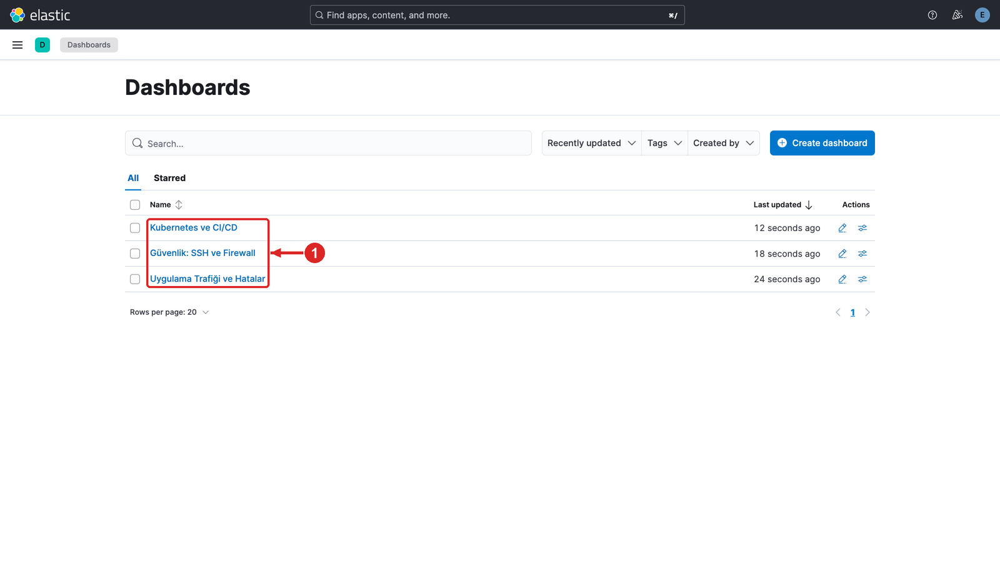
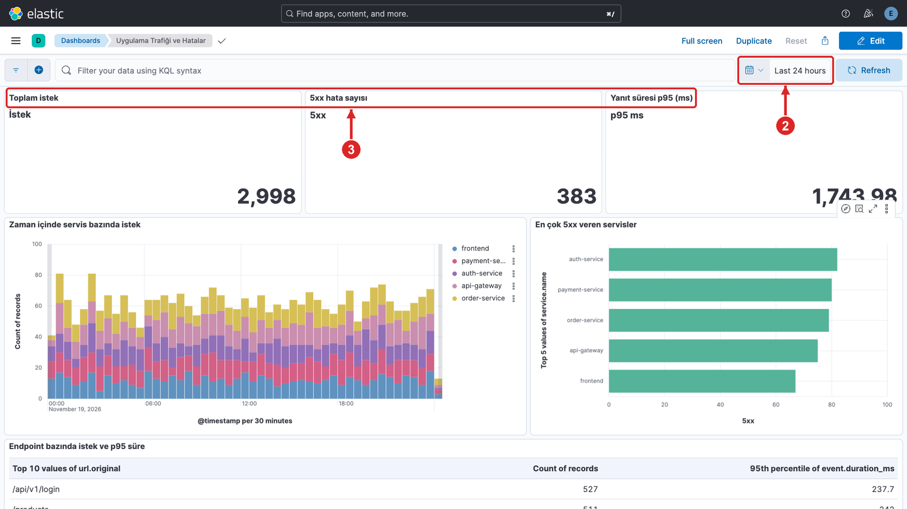
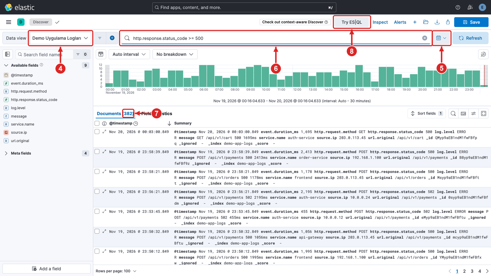
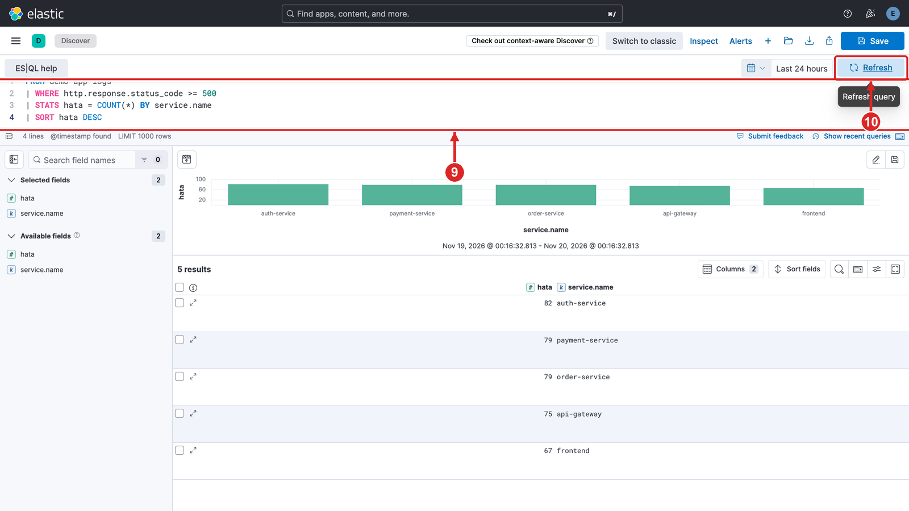

# LAB-ELK-02 — Örnek Veriyle Kibana: Discover, KQL, ES|QL ve Hazır Panolar

| Profil / Araçlar | Açık Portlar |
|---|---|
| Kibana 8.19 (Discover, Dashboards, Dev Tools), `python3` | 15601 (Kibana) |

## Amaç

- Son 24 saate yayılmış örnek uygulama, güvenlik, Kubernetes ve CI/CD loglarını yüklemek.
- Hazır panoları açıp okumak.
- Discover'da KQL ile, Discover ve Dev Tools'ta ES|QL ile logları sorgulamak.

## Ön Koşullar

- LAB-ELK-01 stack'i çalışıyor olmalıdır.
- Kibana adresi: `echo "https://$(hostname)-kibana.devopsatolyesi.com"`, kullanıcı `elastic`, parola `DevOps2026!`.

## Mimari ve Çalışma Modeli

Kendi loglarınızı toplamadan önce aramayı ve panoları hazır, gerçeğe benzer bir veriyle öğrenirsiniz.

| Kavram | Ne işe yarar |
|---|---|
| **Data view** | Kibana'ya hangi index'lerin okunacağını ve zaman alanını söyler. Discover ve panolar data view üzerinden çalışır. |
| **Discover** | Belgeleri tek tek görür; arama çubuğuna yazdığınız sorguyla süzersiniz. |
| **KQL** (Kibana Query Language) | Discover'ın arama dili. Belgeleri **süzer**: `alan : değer`, `and`, `or`, `not`, `>=`, `*`. Sonuç belge listesidir. |
| **ES\|QL** (Elasticsearch Query Language) | Komutları `\|` ile zincirleyen sorgu dili. Süzmenin yanında **hesaplar**: gruplar, sayar, ortalama ve yüzdelik alır, sıralar. Sonuç tablodur. |
| **Dashboard** | Birden çok paneli tek ekranda toplar; zaman aralığı ve filtre bütün panellere birlikte uygulanır. |

Veriyi ve panoları `scripts/` klasöründeki iki betik kurar:

| Betik | Ne yapar |
|---|---|
| `generate_demo_data.py` | Dört `demo-*` index'ini yeniden oluşturur, son 24 saate yayılmış belgeler yazar. Alan türlerini baştan belirler; sayılar her kurulumda aynıdır. |
| `create_dashboards.py` | Data view'ları ve üç panoyu Kibana API'siyle kurar. |

## Adım Adım Uygulama Rehberi

### 1. Örnek veriyi ve panoları kurma

```bash
cd ~/elk-lab/02-kibana-sample-data
python3 scripts/generate_demo_data.py
```

```text
[+] demo-app-logs: 3000 belge
[+] demo-security-logs: 1500 belge
[+] demo-k8s-logs: 2000 belge
[+] demo-cicd-logs: 1500 belge
```

```bash
python3 scripts/create_dashboards.py
```

```text
[+] Data view: Demo Uygulama Logları (demo-app-logs)
[+] Data view: Demo Güvenlik Logları (demo-security-logs)
[+] Data view: Demo Kubernetes Olayları (demo-k8s-logs)
[+] Data view: Demo CI/CD Pipeline Logları (demo-cicd-logs)
[+] Pano: Uygulama Trafiği ve Hatalar  ->  /app/dashboards#/view/demo-app-overview
[+] Pano: Güvenlik: SSH ve Firewall  ->  /app/dashboards#/view/demo-security-overview
[+] Pano: Kubernetes ve CI/CD  ->  /app/dashboards#/view/demo-k8s-cicd-overview
```

### 2. Hazır panoları okuma

Kibana menüsünden **Analytics > Dashboards**'u açın. Üç pano listededir (1).

{width=75%}

**Uygulama Trafiği ve Hatalar** panosunu açın. Panolar açılışta son 24 saati gösterir (2). Üst sıradaki sayı kartları (3) genel durumu, altındaki grafikler ayrıntıyı verir:

{width=75%}

| Pano | Cevapladığı sorular |
|---|---|
| Uygulama Trafiği ve Hatalar | Kaç istek geldi, kaçı 5xx, hangi servis en çok hata veriyor, hangi endpoint yavaş? |
| Güvenlik: SSH ve Firewall | Kaç başarısız SSH girişi var, hangi IP'ler deniyor, hangi kullanıcı adları deneniyor? |
| Kubernetes ve CI/CD | Kaç OOMKilled var, hangi namespace'te sorun var, pipeline'ların yüzde kaçı başarısız, hangi stage yavaş? |

Zaman seçicisini (2) değiştirince bütün paneller birlikte güncellenir. Bir çubuğa tıklamak o değeri bütün panoya filtre olarak ekler.

### 3. Discover'da KQL ile arama

1. Menüden **Analytics > Discover**'ı açın.
2. Data view seçicisinden (4) **Demo Uygulama Logları**'nı seçin.
3. Zaman aralığını (5) **Last 24 hours** yapın.
4. Arama çubuğuna (6) yazıp Enter'a basın; belge sayısı (7) yalnız 5xx hatalarını gösterir:

```text
http.response.status_code >= 500
```

{width=75%}

Başka sorgular deneyin:

| Soru | KQL |
|---|---|
| Ödeme servisindeki 5xx hataları | `service.name : "payment-service" and http.response.status_code >= 500` |
| `/api/v1/` ile başlayan istekler | `url.original : /api/v1/*` |
| 1 saniyeden yavaş istekler | `event.duration_ms > 1000` |
| Başarılı olmayan her şey | `not log.level : "INFO"` |

KQL belgeleri süzer, ama "hangi servis kaç hata verdi" gibi sayım yapamaz. Bunun için ES|QL kullanılır.

### 4. ES|QL ile hesaplama

ES|QL `FROM` ile başlar; her `|` bir öncekinin sonucunu işler: `WHERE` süzer, `STATS ... BY` gruplayıp hesaplar, `SORT` sıralar, `LIMIT` sınırlar.

**Discover'da:**

1. Discover'da **Try ES|QL**'e (8, önceki görüntüde) tıklayın.
2. Sorguyu kutuya (9) yazıp **Refresh**'e (10) ya da `Ctrl+Enter`'a basın; sonuç tablo olarak gelir:

```text
FROM demo-app-logs
| WHERE http.response.status_code >= 500
| STATS hata = COUNT(*) BY service.name
| SORT hata DESC
```

{width=75%}

Discover zaman aralığını ES|QL'e de uygular; en eski birkaç belge dışarıda kaldığı için sayılar Dev Tools'takinden biraz küçük olabilir. Normal Discover'a **Switch to classic** ile dönersiniz.

**Dev Tools'ta:** Aynı sorgular `_query` API'siyle çalışır; `format=txt` tablo verir, zaman filtresi yoktur.

Servis başına 5xx hata sayısı:

```http
POST _query?format=txt
{
  "query": "FROM demo-app-logs | WHERE http.response.status_code >= 500 | STATS hata = COUNT(*) BY service.name | SORT hata DESC"
}
```

```text
     hata      | service.name  
---------------+---------------
82             |auth-service   
80             |payment-service
79             |order-service  
75             |api-gateway    
67             |frontend       
```

En çok başarısız SSH girişi deneyen 5 IP (JSON içindeki tırnaklar `\"` ile yazılır):

```http
POST _query?format=txt
{
  "query": "FROM demo-security-logs | WHERE event.action == \"ssh_login\" AND event.outcome == \"failure\" | STATS deneme = COUNT(*) BY source.ip | SORT deneme DESC | LIMIT 5"
}
```

```text
    deneme     |   source.ip   
---------------+---------------
260            |198.51.100.77  
240            |203.0.113.45   
234            |185.220.101.5  
224            |45.154.255.89  
```

Endpoint başına istek sayısı ve p95 süre (isteklerin %95'i bu sürenin altında kalır; ortalama yavaş istekleri gizler, p95 gizlemez):

```http
POST _query?format=txt
{
  "query": "FROM demo-app-logs | STATS istek = COUNT(*), p95_ms = ROUND(PERCENTILE(event.duration_ms, 95)) BY url.original | SORT p95_ms DESC"
}
```

```text
     istek     |    p95_ms     |  url.original  
---------------+---------------+----------------
497            |2480.0         |/api/v1/payments
508            |2190.0         |/api/v1/cart    
465            |1859.0         |/api/v1/orders  
511            |242.0          |/products       
527            |238.0          |/api/v1/login   
492            |236.0          |/healthz        
```

Adım 2'deki panolar bu hesaplamaları çizer.

## Temizlik

Örnek index'leri silmek için:

```bash
curl -s -u elastic:'DevOps2026!' -X DELETE "http://localhost:9200/demo-app-logs,demo-security-logs,demo-k8s-logs,demo-cicd-logs" | jq -c .
```

```text
{"acknowledged":true}
```

Panolar ve data view'lar Kibana'da kalır, ama verisi olmadığı için boş görünür. Stack'in tamamı LAB-01 temizliğiyle (`docker compose down -v`) silinir.

Sonraki lab: **[LAB-ELK-03 — Filebeat ile Linux ve Docker Logları](../03-filebeat-host-docker/README.md)**
