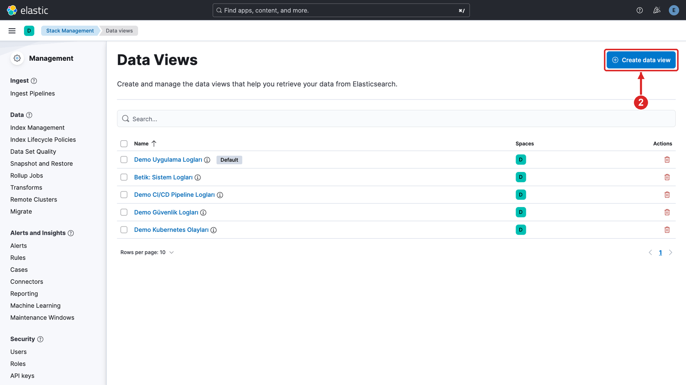
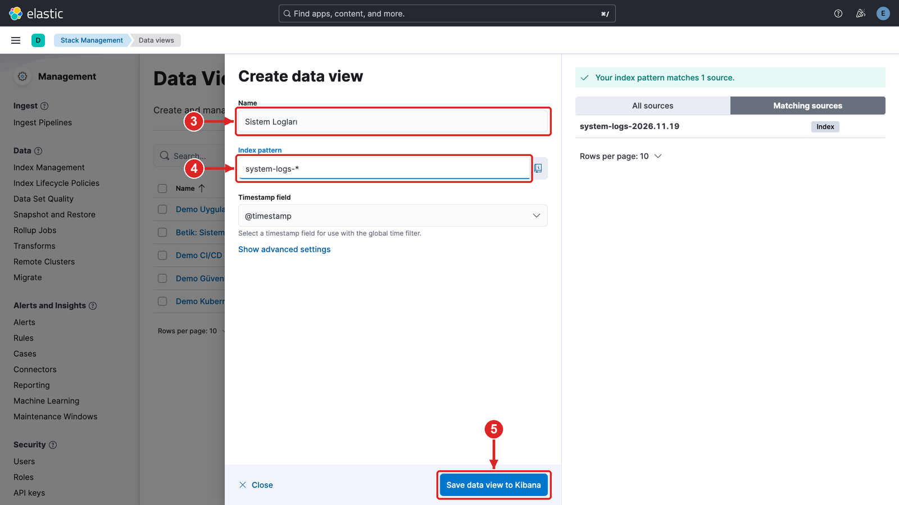
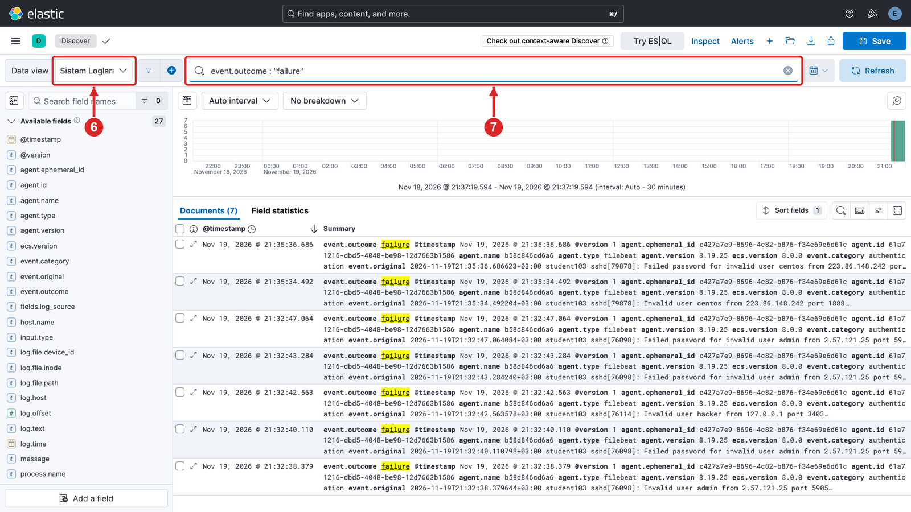
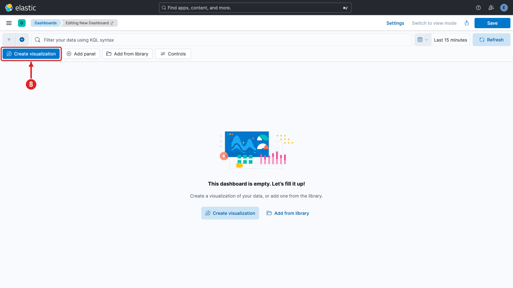
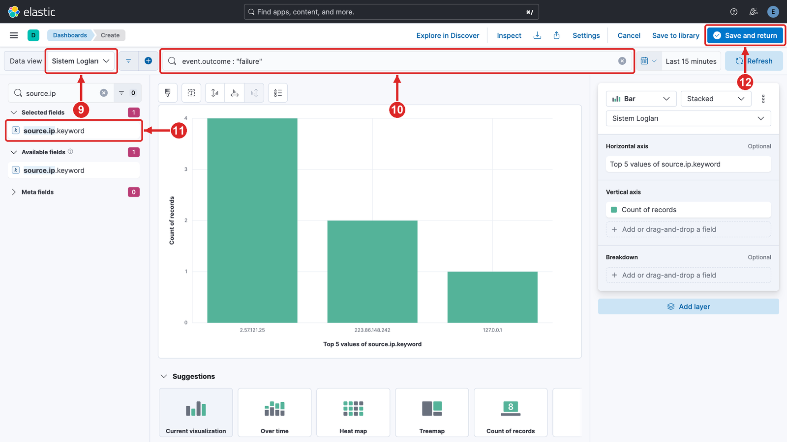
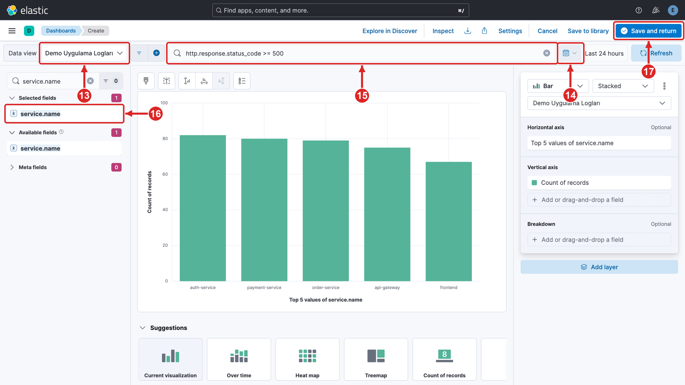
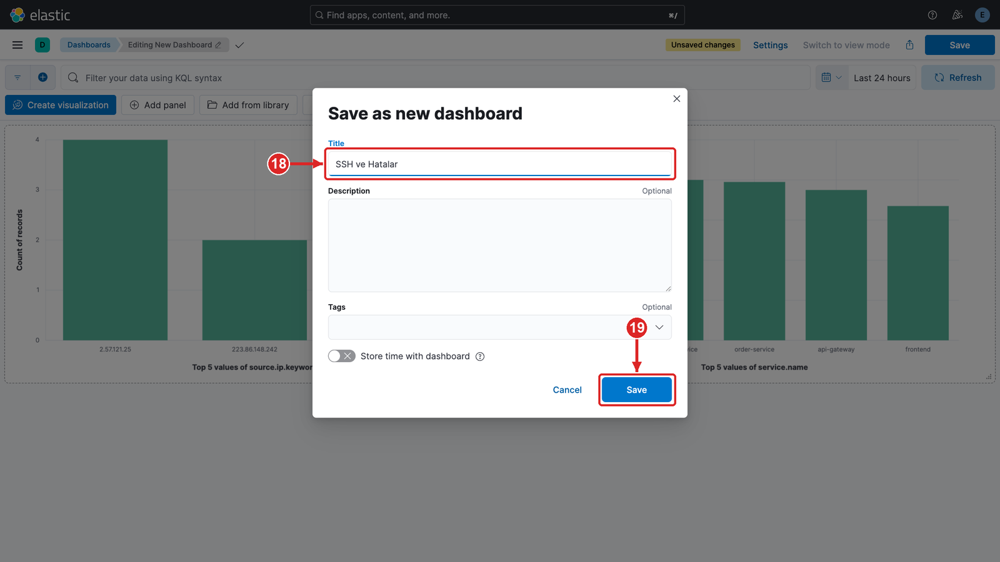

# LAB-ELK-02 — Kibana: Discover, Lens ve Hazır Panolar

| Profil / Araçlar | Açık Portlar |
|---|---|
| Kibana 8.19 (Discover, Lens, Dashboards), `python3` | 15601 (Kibana) |

## Amaç

- Hazır demo verisini ve üç operasyon panosunu tek komutla kurmak.
- Kendi logunuz için data view oluşturup Discover'da KQL ile aramak.
- Lens ile bir grafik çizip panoya kaydetmek.

## Ön Koşullar

- LAB-ELK-01 stack'i çalışıyor olmalıdır.
- Adım 2-4 için LAB-ELK-04 sonrası `system-logs-*` index'inde ayrışmış SSH satırları olmalıdır.
- Kibana adresi: `echo "https://$(hostname)-kibana.devopsatolyesi.com"`, kullanıcı `elastic`, parola `DevOps2026!`.

## Mimari ve Çalışma Modeli

| Kavram | Ne işe yarar |
|---|---|
| **Data view** | Kibana'ya hangi index'lerin okunacağını söyler (`system-logs-*` gibi) ve zaman alanını seçer. Discover, Lens ve panolar data view üzerinden çalışır. |
| **Discover** | Belgeleri tek tek görür, KQL ile filtrelersiniz. |
| **KQL** | Arama dili: `alan : değer`, `and`, `or`, `not`, `>=`, `*`. |
| **Lens** | Alanı sürükleyip bırakarak grafik çizer. |
| **Dashboard** | Birden çok Lens panelini tek ekranda toplar; zaman aralığı ve filtre hepsine birlikte uygulanır. |

Hazır panolar `scripts/` klasöründeki iki betikle kurulur:

| Betik | Ne yapar |
|---|---|
| `generate_demo_data.py` | Son 24 saate yayılmış sentetik uygulama, güvenlik, Kubernetes ve CI/CD logu üretir; yalnız `demo-*` index'lerine yazar. Gerçek lab logları (`system-logs-*` vb.) ile karışmaz. |
| `create_dashboards.py` | Data view'ları ve dört panoyu Kibana API'siyle kurar; panelleri `lens_builder.py` ile üretip göndermeden önce doğrular. |

## Adım Adım Uygulama Rehberi

### 1. Hazır panoları kurma

```bash
cd ~/elk-lab/02-kibana-sample-data
python3 scripts/generate_demo_data.py
```

```text
[+] demo-app-logs: 3000 belge
[+] demo-security-logs: 1500 belge
[+] demo-k8s-logs: 2000 belge
[+] demo-cicd-logs: 1500 belge
```

```bash
python3 scripts/create_dashboards.py
```

```text
[+] Data view: Demo Uygulama Logları (demo-app-logs)
[+] Data view: Demo Güvenlik Logları (demo-security-logs)
[+] Data view: Demo Kubernetes Olayları (demo-k8s-logs)
[+] Data view: Demo CI/CD Pipeline Logları (demo-cicd-logs)
[+] Data view: Betik: Sistem Logları (system-logs-*)
[+] Pano: Uygulama Trafiği ve Hatalar  ->  /app/dashboards#/view/demo-app-overview
[+] Pano: Güvenlik: SSH ve Firewall  ->  /app/dashboards#/view/demo-security-overview
[+] Pano: Kubernetes ve CI/CD  ->  /app/dashboards#/view/demo-k8s-cicd-overview
[+] Pano: SSH ve Hatalar (betik)  ->  /app/dashboards#/view/ssh-errors-script
```

Kibana menüsünden **Analytics > Dashboards**'u açın. Dört pano listededir (1); birine tıklayın.

{width=75%}

| Pano | Cevapladığı sorular |
|---|---|
| Uygulama Trafiği ve Hatalar | Kaç istek geldi, kaçı 5xx, hangi servis en çok hata veriyor, hangi endpoint yavaş? |
| Güvenlik: SSH ve Firewall | Kaç başarısız SSH girişi var, hangi IP'ler deniyor, hangi kullanıcı adları deneniyor? |
| Kubernetes ve CI/CD | Kaç OOMKilled var, hangi namespace'te sorun var, pipeline'ların yüzde kaçı başarısız, hangi stage yavaş? |
| SSH ve Hatalar (betik) | Adım 4'te elle kuracağınız panonun betikle kurulmuş hâli: hangi IP'ler SSH ile deniyor, hangi servis 5xx veriyor? |

Panolar açılışta son 24 saati gösterir. Sağ üstteki zaman seçicisini değiştirince bütün paneller birlikte güncellenir.

### 2. Data view oluşturma

Kendi SSH loglarınız için bir data view oluşturun. Logstash her gün yeni bir index açar (`system-logs-2026.11.19`, `system-logs-2026.11.20`…). Index pattern'deki `*`, bunların hepsini tek data view altında toplar. **Timestamp field**, Kibana'nın sağ üstteki zaman seçicisiyle hangi alana göre filtreleyeceğini belirler; seçilmezse "son 24 saat" gibi filtreler çalışmaz.

1. Menüden **Management > Stack Management > Data Views**'a gidin ve **Create data view**'a (2) tıklayın.

   {width=75%}

2. **Name** (3): `Sistem Logları`
3. **Index pattern** (4): `system-logs-*`. Sağda eşleşen index görünür. **Timestamp field** `@timestamp` kalır.
4. **Save data view to Kibana**'ya (5) tıklayın.

   {width=75%}

### 3. Discover ve KQL

1. Menüden **Analytics > Discover**'ı açın.
2. Sol üstteki data view seçicisinden (6) **Sistem Logları**'nı seçin (listede görünmüyorsa arama kutusuna `Sistem` yazın).
3. Sağ üstten zaman aralığını **Last 24 hours** yapın.
4. Arama çubuğuna (7) aşağıdaki KQL sorgusunu yazıp Enter'a basın. `event.outcome` alanını Logstash'teki grok filtresi üretti; başarısız SSH girişlerinde `failure` değerini alır. Sorgu, `auth.log`'daki binlerce satırdan yalnız başarısız girişleri listeler:

```text
event.outcome : "failure"
```

{width=75%}

Başka sorgular deneyin:

| Soru | KQL |
|---|---|
| `root` ile denenen girişler | `event.outcome : "failure" and user.name : "root"` |
| Kendi denemeniz | `source.ip : "127.0.0.1"` |
| SSH dışındaki kayıtlar | `not process.name : "sshd"` |

### 4. Lens ile grafik ve pano

1. **Analytics > Dashboards > Create dashboard**'a tıklayın, sonra **Create visualization**'a (8) tıklayın.

   {width=75%}

2. Sol üstte data view olarak **Sistem Logları**'nı seçin (9).
3. Arama çubuğuna (10) `event.outcome : "failure"` yazıp Enter'a basın.
4. Sol listede `source.ip` arayın ve **source.ip.keyword** alanını (11) ortadaki boş alana sürükleyin. Lens, IP başına başarısız giriş sayısını çubuk grafik olarak çizer. Gruplama için `.keyword` hâli kullanılır: metin alanı kelimelere bölünerek saklanır, keyword hâli ise değeri bölmeden tutar ve sayılabilir.
5. Sağ üstteki **Save and return**'e (12) tıklayın.

   {width=75%}

Şimdi aynı panoya, betiğin kurduğu **Uygulama Trafiği ve Hatalar** panosundaki "En çok 5xx veren servisler" panelini elle ekleyin:

6. Panoda tekrar **Create visualization**'a tıklayın.
7. Data view olarak **Demo Uygulama Logları**'nı (13) seçin. Zaman aralığını (14) **Last 24 hours** yapın; demo verisi son 24 saate yayılmıştır.
8. Arama çubuğuna (15) `http.response.status_code >= 500` yazıp Enter'a basın.
9. **service.name** alanını (16) ortaya sürükleyin. Lens servis başına 5xx sayısını çubuk grafik olarak çizer.
10. **Save and return**'e (17) tıklayın.

   {width=75%}

11. Panoda sağ üstteki **Save**'e tıklayın, başlığa (18) `SSH ve Hatalar` yazıp **Save**'e (19) tıklayın.

   {width=75%}

Kendi kurduğunuz **SSH ve Hatalar** panosunu betiğin kurduğu **SSH ve Hatalar (betik)** panosuyla yan yana açın: iki panel de aynı sayıları gösterir. Betik, sizin arayüzde seçtiğiniz data view'ı, sorguyu ve alanı Kibana API'sine gönderir. Birinci paneldeki IP'ler ise sunucunuza internetten SSH ile girmeye çalışan gerçek adreslerdir.

## Temizlik

Demo index'lerini silmek için:

```bash
curl -s -u elastic:'DevOps2026!' -X DELETE "http://localhost:9200/demo-app-logs,demo-security-logs,demo-k8s-logs,demo-cicd-logs" | jq -c .
```

Panolar ve data view'lar Kibana'da kalır; LAB-01 temizliği (`docker compose down -v`) hepsini siler.

Sonraki lab: **[LAB-ELK-06 — SIEM: Detection Rule ve Alert](../06-siem-detection/README.md)**
