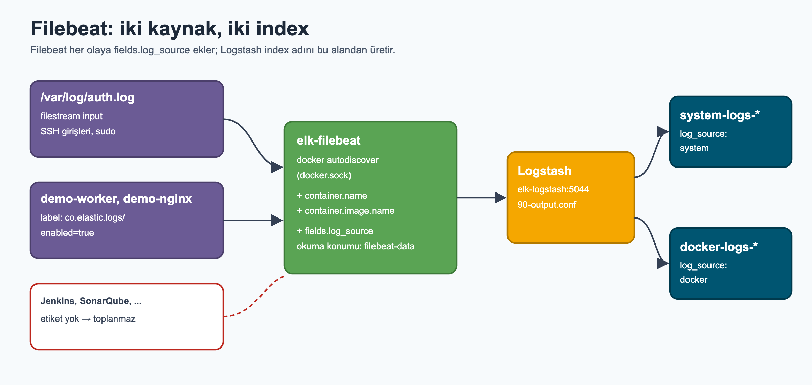

# LAB-ELK-03 — Filebeat ile Linux ve Docker Logları

| Profil / Araçlar | Açık Portlar |
|---|---|
| Filebeat 8.19, `docker compose` | Yeni port açılmaz (Filebeat → `elk-logstash:5044`) |

## Amaç

- Sunucunun SSH ve sudo kayıtlarını (`/var/log/auth.log`) Filebeat ile toplamak.
- Etiketli Docker container'larının loglarını container adı ve image bilgisiyle toplamak.
- Logların Logstash üzerinden `system-logs-*` ve `docker-logs-*` index'lerine yazıldığını görmek.

## Ön Koşullar

- LAB-ELK-01 stack'i çalışıyor olmalıdır (`elk-net` ağı ve `elk-logstash` container'ı).

## Mimari ve Çalışma Modeli

{width=60%}

Filebeat sunucuda tek bir container olarak çalışır ve iki kaynağı okur:

| Kaynak | Nasıl okunur | Eklenen alan | Index |
|---|---|---|---|
| `/var/log/auth.log` | `filestream` input | `fields.log_source: system` | `system-logs-*` |
| Docker container logları | `docker` autodiscover; yalnız `co.elastic.logs/enabled=true` etiketli container'lar | `fields.log_source: docker`, `container.name`, `container.image.name` | `docker-logs-*` |

Etiket şartı, sunucudaki bütün container'ların (Jenkins, SonarQube…) loglarını toplamamak içindir. Logstash index adını `log_source` alanından üretir (`01-elk-stack-setup/pipeline/90-output.conf`).

<details>
<summary><strong>filebeat.yml ve compose satırları</strong></summary>

| Satır | Ne işe yarar |
|---|---|
| `type: filestream`, `paths: /var/log/auth.log` | Dosyayı satır satır okur; okuduğu yeri `filebeat-data` volume'unda tutar, yeniden başlayınca kaldığı yerden devam eder. |
| `hints.enabled: true`, `default_config.enabled: false` | Container'lar varsayılan olarak toplanmaz; etiketle açılır. |
| `type: container` | Docker'ın JSON log satırını açar; `message` alanına yalnız uygulamanın yazdığı satır gelir. |
| `hosts: ["elk-logstash:5044"]` | Filebeat `elk-net` ağında olduğu için Logstash'e container adıyla bağlanır. |
| `user: root`, `/var/log:/var/log:ro` | `auth.log` yalnız root ve `adm` grubunca okunabilir. |
| `/var/run/docker.sock:ro` | Autodiscover, başlayan container'ları ve etiketlerini Docker API'den izler. |

</details>

## Adım Adım Uygulama Rehberi

### 1. Filebeat'i başlatma

Compose tek bir container (`elk-filebeat`) başlatır. Container, `filebeat.yml`'i ve sunucunun `/var/log`, Docker log klasörü ile `docker.sock` dosyasını salt okunur bağlar; böylece sunucudaki logları container'ın içinden okuyabilir.

```bash
cd ~/elk-lab/03-filebeat-host-docker
docker compose up -d
```

Filebeat açılınca `elk-logstash:5044` adresine bağlanmaya çalışır. Bağlantı kurulunca loguna `Connection ... established` yazar; bu satır yoksa Logstash ayakta değildir ya da Filebeat `elk-net` ağına katılamamıştır. `sleep 15`, Filebeat'in açılıp bağlanması için süre tanır:

```bash
sleep 15
docker logs elk-filebeat 2>&1 | grep -o 'Connection to backoff(async(tcp://elk-logstash:5044)) established' | head -1
```

```text
Connection to backoff(async(tcp://elk-logstash:5044)) established
```

### 2. Linux loglarını görme

Filebeat bir dosyayı ilk kez gördüğünde baştan okur ve nereye kadar okuduğunu `filebeat-data` volume'undaki kayıt dosyasına (registry) yazar. Yeniden başlarsa kaldığı yerden devam eder, aynı satırı iki kez göndermez. `auth.log` büyük olabileceği için (sunucuya internetten sürekli SSH denemesi gelir) belge sayısı bir süre artmaya devam eder:

```bash
sleep 20
curl -s -u elastic:'DevOps2026!' "http://localhost:9200/_cat/indices/system-logs-*?v&h=index,docs.count"
```

Toplamanın çalıştığını kendi ürettiğiniz bir satırla kanıtlayın: sunucuya var olmayan `deneme` kullanıcısıyla SSH girişi deneyin. SSH sunucusu (`sshd`) bu denemeyi `auth.log`'a `Invalid user deneme` olarak yazar. Parametreler:

- `BatchMode=yes`: parola sormaz; giriş hemen reddedilir.
- `StrictHostKeyChecking=no`, `UserKnownHostsFile=/dev/null`: "bu sunucuya güveniyor musunuz?" sorusunu sormaz ve anahtarı kaydetmez.
- `LogLevel=ERROR`: istemcinin uyarı satırlarını gizler.

`Permission denied` çıktısı beklenen sonuçtur:

```bash
ssh -o BatchMode=yes -o StrictHostKeyChecking=no -o UserKnownHostsFile=/dev/null -o LogLevel=ERROR deneme@localhost true
```

```text
deneme@localhost: Permission denied (publickey,password,keyboard-interactive).
```

Filebeat önce dosyadaki eski satırları gönderir; sizin satırınız dosyanın sonunda olduğu için en son gelir. `until` döngüsü, `deneme` geçen belge sayısı 0'dan büyük olana kadar 10 saniyede bir sorar; satır gelince durur (birkaç dakika sürebilir). Ardından toplam belge sayısını gösterir:

```bash
until curl -s -u elastic:'DevOps2026!' "http://localhost:9200/system-logs-*/_count?q=message:deneme" | jq -e '.count > 0' > /dev/null; do sleep 10; done
curl -s -u elastic:'DevOps2026!' "http://localhost:9200/_cat/indices/system-logs-*?v&h=index,docs.count"
```

Satırı görün:

```bash
curl -s -u elastic:'DevOps2026!' "http://localhost:9200/system-logs-*/_search?q=message:deneme&size=1&filter_path=hits.hits._source&_source=message,log.file.path,fields" | jq '.hits.hits[0]._source'
```

```json
{
  "fields": {
    "log_source": "system"
  },
  "log": {
    "file": {
      "path": "/var/log/auth.log"
    }
  },
  "message": "2026-11-19T19:02:13.418503+03:00 student103 sshd[20512]: Invalid user deneme from 127.0.0.1 port 51874"
}
```

Satırın tamamı tek bir `message` alanında duruyor; kullanıcı adı ve IP ayrı alan değil. Bu yüzden "hangi IP kaç kez denedi" gibi sorular sorulamaz; yalnız metin içinde arama yapılabilir. Satırı alanlara ayırmak için Logstash'te grok filtresi gerekir; Filebeat satırı olduğu gibi taşır.

### 3. Docker loglarını görme

Etiketli bir test container'ı çalıştırın. `--label co.elastic.logs/enabled=true`, Filebeat'e "bu container'ın logunu topla" der; autodiscover container başlarken etiketi görür ve o container için bir okuyucu açar. Container üç satır yazar ve kapanır:

- `--rm`: container kapanınca silinir.
- `sleep 10`: container'ı 10 saniye daha açık tutar. Container hemen kapanırsa autodiscover okuyucuyu da kapatır ve son satırlar okunmadan kalabilir.

```bash
docker run --rm --name demo-worker --label co.elastic.logs/enabled=true alpine \
  sh -c 'for i in 1 2 3; do echo "job $i tamamlandi"; sleep 1; done; sleep 10'
```

```text
job 1 tamamlandi
job 2 tamamlandi
job 3 tamamlandi
```

Aynı şeyi etiketsiz bir container'la yapın; bu container'ın logu toplanmaz:

```bash
docker run --rm --name demo-etiketsiz alpine echo "bu satir toplanmaz"
```

Son 5 container logunu en yeniden eskiye (`sort=@timestamp:desc`) sıralayıp sorgulayın:

```bash
sleep 10
curl -s -u elastic:'DevOps2026!' "http://localhost:9200/docker-logs-*/_search?size=5&sort=@timestamp:desc&filter_path=hits.hits._source&_source=message,container.name,container.image.name" | jq -c '.hits.hits[]._source'
```

```text
{"container":{"image":{"name":"alpine"},"name":"demo-worker"},"message":"job 3 tamamlandi"}
{"container":{"image":{"name":"alpine"},"name":"demo-worker"},"message":"job 2 tamamlandi"}
{"container":{"image":{"name":"alpine"},"name":"demo-worker"},"message":"job 1 tamamlandi"}
```

`demo-etiketsiz` sonuçta yoktur; `container.name` ve `container.image.name` alanlarını autodiscover ekledi.

## Temizlik

Filebeat LAB-04 ve LAB-06'da da kullanılır; açık bırakın. Lablar bitince:

```bash
cd ~/elk-lab/03-filebeat-host-docker
docker compose down -v
```

`-v`, Filebeat'in okuma konumunu tutan `filebeat-data` volume'unu da siler. Elasticsearch'teki index'ler kalır.

Sonraki lab: **[LAB-ELK-04 — Logstash Grok ile Log Ayrıştırma](../04-logstash-grok/README.md)**
