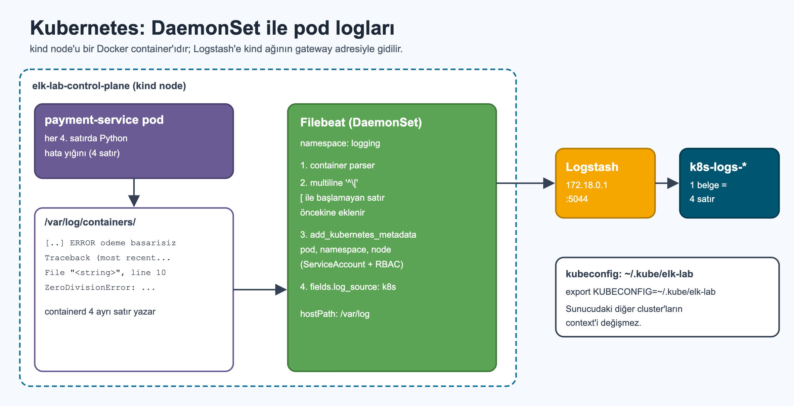

# LAB-ELK-04 — Kubernetes Pod Logları

| Profil / Araçlar | Açık Portlar |
|---|---|
| `kind`, `kubectl`, Filebeat 8.19 DaemonSet | Yeni port açılmaz (Filebeat → sunucu `5044`) |

## Amaç

- Kendi kind cluster'ınızda Filebeat'i DaemonSet olarak çalıştırmak.
- Pod loglarına pod, namespace ve node bilgisini eklemek.
- Çok satırlı Python hata yığınını tek belge olarak toplamak.

## Ön Koşullar

- LAB-ELK-01 stack'i çalışıyor olmalıdır (Logstash `5044` sunucuda yayında).
- Sunucuda `kind` ve `kubectl` kurulu olmalıdır.
- Lab kendi `elk-lab` cluster'ını ve kendi kubeconfig dosyasını (`~/.kube/elk-lab`) kullanır; sunucudaki diğer cluster'lara dokunmaz.

## Mimari ve Çalışma Modeli

{width=60%}

- Container'ların stdout/stderr çıktısı node'da `/var/log/containers/*.log` dosyalarına yazılır.
- DaemonSet her node'da bir Filebeat pod'u çalıştırır; pod bu klasörü `hostPath` ile okur.
- `add_kubernetes_metadata` dosya adından pod'u bulur, Kubernetes API'den pod, namespace ve node bilgisini ekler. Bunun için ServiceAccount ve ClusterRole gerekir.
- kind node'u bir Docker container'ıdır. Node'dan sunucudaki Logstash'e, kind Docker ağının gateway adresinden (`172.18.0.1` gibi) `5044` portuyla gidilir.

`payment-service` her 4. satırda bir Python hata yığını basar:

```text
[2026-11-19 16:47:08] ERROR odeme basarisiz order=2152
Traceback (most recent call last):
  File "<string>", line 10, in <module>
ZeroDivisionError: division by zero
```

Kubernetes bunu dört ayrı satır olarak yazar. `multiline` ayarı `[` ile başlamayan satırı bir öncekine ekler; dört satır tek olay olur.

<details>
<summary><strong>filebeat-daemonset.yaml'daki önemli satırlar</strong></summary>

| Satır | Ne işe yarar |
|---|---|
| `paths: /var/log/containers/payment-service-*.log` | Yalnız demo uygulamanın logları; cluster bileşenlerinin logları toplanmaz. |
| `parsers: - container: ~` | containerd log satırının önündeki zaman ve stream bilgisini ayırır. |
| `multiline: pattern: '^\['`, `negate: true`, `match: after` | `[` ile başlamayan satır, önceki olaya eklenir. |
| `fields: log_source: k8s` | Logstash bu alanla `k8s-logs-*` index'ine yazar. |
| `value: "LOGSTASH_IP:5044"` | Kurulumda `sed` ile kind ağının gateway IP'si yazılır. |
| `runAsUser: 0` | Node'daki log dosyaları root'a aittir. |

</details>

## Adım Adım Uygulama Rehberi

### 1. Cluster'ı kurma

kind, Kubernetes node'larını Docker container'ı olarak çalıştırır. `kind-config.yaml` tek node'lu `elk-lab` cluster'ını tanımlar. `--kubeconfig ~/.kube/elk-lab`, bağlantı bilgisini ayrı bir dosyaya yazar; varsayılan `~/.kube/config` dosyası ve sunucudaki diğer cluster'ların ayarı değişmez:

```bash
cd ~/elk-lab/04-kubernetes-logs
kind create cluster --config kind-config.yaml --kubeconfig ~/.kube/elk-lab
```

`KUBECONFIG` değişkeni, bu terminalde `kubectl`'in hangi dosyayı okuyacağını belirler. Node'un hazır olması (`Ready`) birkaç saniye sürer; `kubectl wait` hazır olana kadar bekler:

```bash
export KUBECONFIG=~/.kube/elk-lab
kubectl wait --for=condition=Ready node --all --timeout=180s
kubectl get nodes
```

```text
node/elk-lab-control-plane condition met
NAME                    STATUS   ROLES           AGE   VERSION
elk-lab-control-plane   Ready    control-plane   40s   v1.37.0
```

### 2. Filebeat DaemonSet'i kurma

Filebeat pod'u, sunucudaki Logstash'e (`5044`) bağlanmalı. kind node'u `kind` adlı Docker ağında çalışan bir container'dır; bu ağın **gateway** adresi, container'ın gözünden sunucunun kendisidir. Logstash `5044` portunu sunucuda yayınladığı için pod bu adresle Logstash'e ulaşır.

`docker network inspect`, ağın IPv4 ve IPv6 gateway adreslerini verir; `grep` yalnız IPv4 olanı alır:

```bash
GW=$(docker network inspect kind -f '{{range .IPAM.Config}}{{.Gateway}} {{end}}' | tr ' ' '\n' | grep -E '^[0-9.]+$')
echo "$GW"
```

```text
172.18.0.1
```

Manifestteki `LOGSTASH_IP` yer tutucusunu `sed` ile bu adresle değiştirip `kubectl`'e gönderin. Manifest; `logging` namespace'ini, Filebeat'in Kubernetes API'sini okuması için ServiceAccount ve ClusterRole'u, ayarlarını tutan ConfigMap'i ve DaemonSet'i oluşturur. `rollout status`, DaemonSet'in her node'da pod'unu çalıştırmasını bekler:

```bash
sed "s/LOGSTASH_IP/$GW/" filebeat-daemonset.yaml | kubectl apply -f -
kubectl rollout status daemonset/filebeat -n logging --timeout=180s
```

```text
namespace/logging created
serviceaccount/filebeat created
clusterrole.rbac.authorization.k8s.io/filebeat created
clusterrolebinding.rbac.authorization.k8s.io/filebeat created
configmap/filebeat-config created
daemonset.apps/filebeat created
daemon set "filebeat" successfully rolled out
```

### 3. Uygulamayı çalıştırma

```bash
kubectl apply -f payment-app.yaml
kubectl rollout status deployment/payment-service --timeout=180s
```

Uygulamanın kendi çıktısına bakın. Hata yığını burada dört ayrı satırdır; Elasticsearch'te nasıl göründüğünü bir sonraki adımda karşılaştıracağız:

```bash
sleep 15
kubectl logs deployment/payment-service --tail=6
```

```text
[2026-11-19 16:47:02] INFO odeme tamamlandi order=4642
[2026-11-19 16:47:05] INFO odeme tamamlandi order=5154
[2026-11-19 16:47:08] ERROR odeme basarisiz order=2152
Traceback (most recent call last):
  File "<string>", line 10, in <module>
ZeroDivisionError: division by zero
```

### 4. Logları Elasticsearch'te görme

`Traceback` geçen bir belgeyi alın. `kubernetes.*` alanlarını Filebeat'in `add_kubernetes_metadata` işlemcisi ekledi: log hangi pod'dan, hangi namespace'ten, hangi node'dan geldi:

```bash
sleep 20
curl -s -u elastic:'DevOps2026!' "http://localhost:9200/k8s-logs-*/_search?q=message:Traceback&size=1&filter_path=hits.hits._source&_source=message,kubernetes.pod.name,kubernetes.namespace,kubernetes.node.name,kubernetes.container.name" | jq '.hits.hits[0]._source'
```

```json
{
  "kubernetes": {
    "container": {
      "name": "payment"
    },
    "node": {
      "name": "elk-lab-control-plane"
    },
    "pod": {
      "name": "payment-service-74d9945869-qglqz"
    },
    "namespace": "default"
  },
  "message": "[2026-11-19 16:47:08] ERROR odeme basarisiz order=2152\nTraceback (most recent call last):\n  File \"<string>\", line 10, in <module>\nZeroDivisionError: division by zero"
}
```

Dört satır tek `message` içinde (`\n` ile). Ayrı satır kalan `Traceback` belgesi olmadığını sayıyla görün:

```bash
curl -s -u elastic:'DevOps2026!' "http://localhost:9200/k8s-logs-*/_count?q=message:ZeroDivisionError%20AND%20NOT%20message:ERROR" | jq .count
```

```text
0
```

## Temizlik

Cluster'ı ve kubeconfig dosyasını silin:

```bash
kind delete cluster --name elk-lab --kubeconfig ~/.kube/elk-lab
rm -f ~/.kube/elk-lab
unset KUBECONFIG
```

`k8s-logs-*` index'leri Elasticsearch'te kalır.

Sonraki lab: **[LAB-ELK-05 — Kibana: Discover, Lens ve Hazır Panolar](../05-kibana-dashboards/README.md)**
