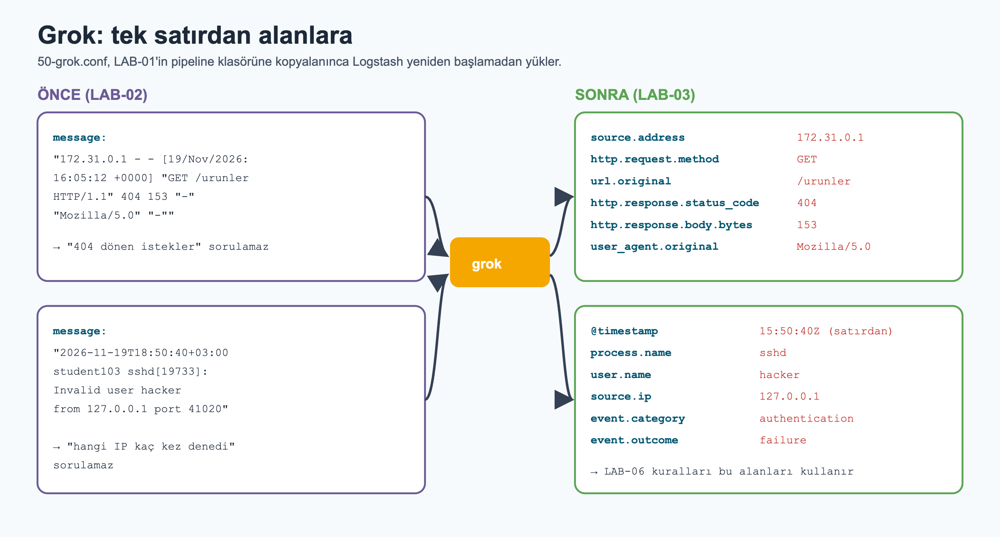
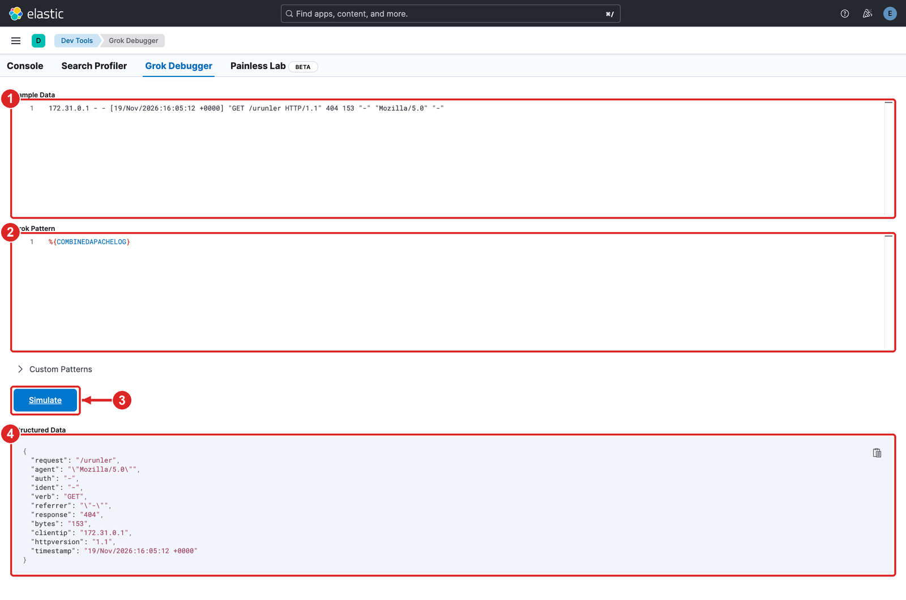
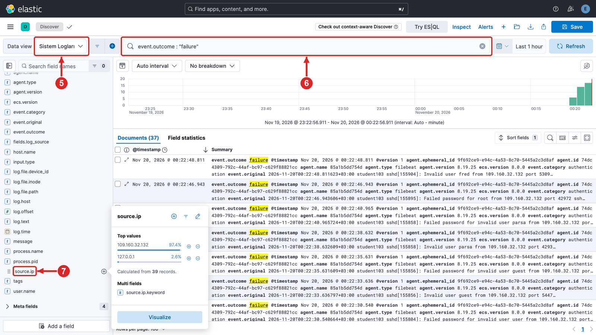
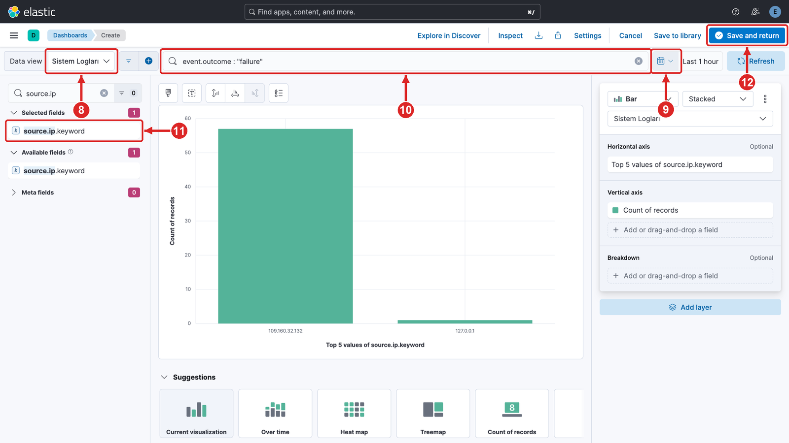
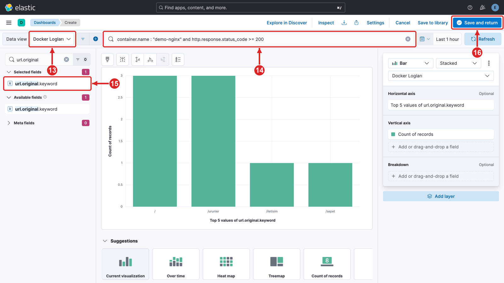
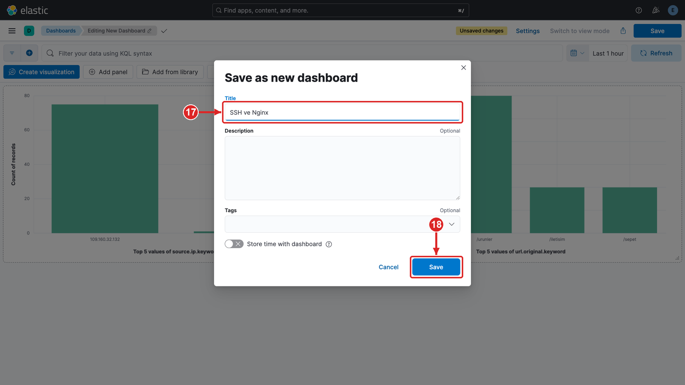

# LAB-ELK-04 — Logstash Grok ile Log Ayrıştırma

| Profil / Araçlar | Açık Portlar |
|---|---|
| Logstash 8.19 (grok, date), `nginx:1.27-alpine` | 8081 (demo Nginx) |

## Amaç

- Nginx erişim satırını ve SSH satırını grok ile alanlara ayırmak; olayın zamanını satırdan almak.
- Ayrıştırmadan önceki ve sonraki belgeyi karşılaştırmak.
- Ayrışan alanlarla Discover'da KQL, Dev Tools'ta ES|QL sorgusu yazmak ve Lens ile pano kurmak.

## Ön Koşullar

- LAB-ELK-01 stack'i ve LAB-ELK-03 Filebeat'i çalışıyor olmalıdır. LAB-ELK-03'te oluşturulan `Sistem Logları` ve `Docker Logları` data view'ları Adım 7-8'de kullanılır.
- `8081` portu boş olmalıdır.

## Mimari ve Çalışma Modeli

{width=60%}

Grok, düz metin satırını bir desene göre parçalar ve her parçayı bir alana yazar. Alan olunca "404 dönen istekler", "en çok deneme yapan IP" gibi sorular sorulabilir.

Logstash, `pipeline/` klasöründeki `.conf` dosyalarını ad sırasıyla birleştirip tek pipeline yapar. Bu labda araya `50-grok.conf` dosyasını koyacağız:

```text
10-input.conf   -> beats girdisi (LAB-01)
50-grok.conf    -> bu labın filtresi
90-output.conf  -> Elasticsearch çıktısı (LAB-01)
```

`50-grok.conf` içindeki iki desen:

| Satır türü | Desen | Üretilen alanlar |
|---|---|---|
| Nginx erişim logu | `%{COMBINEDAPACHELOG}` (hazır desen) | `source.address`, `http.request.method`, `url.original`, `http.response.status_code`, `http.response.body.bytes`, `user_agent.original` |
| `auth.log` satırı | `%{TIMESTAMP_ISO8601} %{SYSLOGHOST} %{DATA}[pid]: %{GREEDYDATA}` | `log.time`, `log.host`, `process.name`, `process.pid`, `log.text` |
| `sshd` mesajı | `Invalid user X from IP`, `Failed password for X from IP`, `Accepted … for X from IP` | `user.name`, `source.ip`, `event.category`, `event.outcome` |

`date` filtresi `@timestamp` alanını satırdaki zamana çeker. Yoksa `@timestamp` satırın okunduğu an olur ve eski bir satır "şimdi olmuş" görünür.

## Adım Adım Uygulama Rehberi

### 1. Demo Nginx'i başlatma

```bash
cd ~/elk-lab/04-logstash-grok
docker compose up -d
```

`demo-nginx` container'ı `co.elastic.logs/enabled: "true"` etiketini taşır; LAB-03'deki Filebeat logunu otomatik toplar. Nginx her isteği **erişim satırı** olarak stdout'a, hataları (ör. dosya bulunamadı) **hata satırı** olarak stderr'e yazar. Filebeat ikisini de gönderir; hangisinden geldiği `stream` alanında (`stdout` / `stderr`) durur.

### 2. Önce: grok olmadan

Nginx'e olmayan bir sayfa (`/urunler`) için istek atın; Nginx `404` döner ve bir erişim satırı yazar.

- `-A "Mozilla/5.0"`: isteğe tarayıcı kimliği (User-Agent) koyar; bu değer erişim satırında görünür.
- `--retry 5 --retry-all-errors`: Nginx henüz açılmadıysa isteği 5 kez tekrar dener.

`until` döngüsü satır Elasticsearch'e düşene kadar bekler; ardından belgeyi gösterir. Sorgudaki `stream:stdout` erişim satırını seçer, aynı istek için yazılan stderr hata satırını dışarıda bırakır:

```bash
curl -s --retry 5 --retry-all-errors -o /dev/null -w "%{http_code}\n" -A "Mozilla/5.0" http://localhost:8081/urunler
```

```text
404
```

```bash
until curl -s -u elastic:'DevOps2026!' "http://localhost:9200/docker-logs-*/_count?q=container.name:demo-nginx%20AND%20message:urunler" | jq -e '.count > 0' > /dev/null; do sleep 5; done
curl -s -u elastic:'DevOps2026!' "http://localhost:9200/docker-logs-*/_search?q=container.name:demo-nginx%20AND%20stream:stdout%20AND%20message:urunler&size=1&sort=@timestamp:desc&filter_path=hits.hits._source&_source=message,http,url,source" | jq '.hits.hits[0]._source'
```

```json
{
  "message": "172.31.0.1 - - [19/Nov/2026:16:05:12 +0000] \"GET /urunler HTTP/1.1\" 404 153 \"-\" \"Mozilla/5.0\" \"-\""
}
```

Yalnız `message` var; `http`, `url`, `source` alanları yok.

### 3. Deseni Grok Debugger'da deneme

Deseni pipeline'a koymadan önce Kibana'da deneyin. Yanlış desen Logstash'te `_grokparsefailure` etiketiyle sessizce kaybolur; burada sonucu hemen görürsünüz.

1. Kibana'da **Management > Dev Tools**'u açıp üstten **Grok Debugger** sekmesine geçin.
2. **Sample Data** alanına (1) önceki adımda gördüğünüz Nginx satırını yapıştırın:

```text
172.31.0.1 - - [19/Nov/2026:16:05:12 +0000] "GET /urunler HTTP/1.1" 404 153 "-" "Mozilla/5.0" "-"
```

3. **Grok Pattern** alanına (2) yazın:

```text
%{COMBINEDAPACHELOG}
```

4. **Simulate**'e (3) tıklayın. **Structured Data** (4) alanında satırın alanlara ayrılmış hâli görünür.

Grok Debugger klasik alan adlarını gösterir; Logstash 8 aynı deseni ECS adlarıyla yazar. Değerler aynıdır, yalnız alan adı farklıdır:

| Grok Debugger | Logstash 8 (ECS) | Değer |
|---|---|---|
| `clientip` | `source.address` | `172.31.0.1` |
| `verb` | `http.request.method` | `GET` |
| `request` | `url.original` | `/urunler` |
| `response` | `http.response.status_code` | `404` |
| `bytes` | `http.response.body.bytes` | `153` |
| `agent` | `user_agent.original` | `Mozilla/5.0` |

{width=75%}

Deseni bozup (ör. `%{COMBINEDAPACHELOG}` yerine `%{IP:ip} %{WORD:yanlis}`) tekrar **Simulate**'e basın; eşleşmeyen desende Kibana hata verir. Logstash'te aynı durum `_grokparsefailure` etiketi olur.

### 4. Grok filtresini ekleme

Filtre dosyasını LAB-01'in pipeline klasörüne kopyalayın. LAB-01'deki `CONFIG_RELOAD_AUTOMATIC=true` ayarı sayesinde Logstash klasörü birkaç saniyede bir kontrol eder, yeni dosyayı görünce pipeline'ı durdurmadan yeniden kurar. Logdaki `Reloading pipeline` satırı yeniden yüklemenin başladığını, `Pipelines running` satırı yeni pipeline'ın çalıştığını gösterir. Dosyada hata olsaydı eski pipeline çalışmaya devam eder ve logda `ERROR` görünürdü:

```bash
cp ~/elk-lab/04-logstash-grok/pipeline/50-grok.conf ~/elk-lab/01-elk-stack-setup/pipeline/
sleep 15
docker logs elk-logstash 2>&1 | grep -E "Reloading pipeline|Pipelines running" | tail -2 | cut -c1-110
```

```text
[2026-11-19T16:05:40,384][INFO ][logstash.pipelineaction.reload] Reloading pipeline {"pipeline.id"=>:main}
[2026-11-19T16:05:52,915][INFO ][logstash.agent           ] Pipelines running {:count=>1, :running_pipelines=>[:main], :non_running_pipelines=>[]}
```

### 5. Sonra: Nginx satırı

Aynı isteği tekrar atın ve ayrışmış satırı bekleyin:

```bash
curl -s --retry 5 --retry-all-errors -o /dev/null -w "%{http_code}\n" -A "Mozilla/5.0" http://localhost:8081/urunler
until curl -s -u elastic:'DevOps2026!' "http://localhost:9200/docker-logs-*/_count?q=url.original:urunler" | jq -e '.count > 0' > /dev/null; do sleep 5; done
curl -s -u elastic:'DevOps2026!' "http://localhost:9200/docker-logs-*/_search?q=container.name:demo-nginx%20AND%20stream:stdout%20AND%20message:urunler&size=1&sort=@timestamp:desc&filter_path=hits.hits._source&_source=http,url,source,user_agent" | jq '.hits.hits[0]._source'
```

```json
{
  "http": {
    "request": {
      "method": "GET"
    },
    "response": {
      "body": {
        "bytes": 153
      },
      "status_code": 404
    },
    "version": "1.1"
  },
  "url": {
    "original": "/urunler"
  },
  "user_agent": {
    "original": "Mozilla/5.0"
  },
  "source": {
    "address": "172.31.0.1"
  }
}
```

`http.response.status_code` artık sayı türünde ayrı bir alan; durum koduna göre sorgu yapılabilir. Grok öncesinde 404 yalnız metnin içinde geçtiği için bu sorgu sonuç vermezdi:

```bash
curl -s -u elastic:'DevOps2026!' "http://localhost:9200/docker-logs-*/_count?q=http.response.status_code:404" | jq .count
```

### 6. Sonra: SSH satırı

Başarısız bir SSH girişi yapın ve ayrışmış belgeye bakın:

```bash
ssh -o BatchMode=yes -o StrictHostKeyChecking=no -o UserKnownHostsFile=/dev/null -o LogLevel=ERROR hacker@localhost true
until curl -s -u elastic:'DevOps2026!' "http://localhost:9200/system-logs-*/_count?q=user.name:hacker" | jq -e '.count > 0' > /dev/null; do sleep 5; done
curl -s -u elastic:'DevOps2026!' "http://localhost:9200/system-logs-*/_search?q=user.name:hacker&size=1&sort=@timestamp:desc&filter_path=hits.hits._source&_source=@timestamp,process,user,source,event.category,event.outcome" | jq '.hits.hits[0]._source'
```

```json
{
  "event": {
    "category": "authentication",
    "outcome": "failure"
  },
  "source": {
    "ip": "127.0.0.1"
  },
  "process": {
    "name": "sshd",
    "pid": "38506"
  },
  "@timestamp": "2026-11-19T16:41:05.922Z",
  "user": {
    "name": "hacker"
  }
}
```

Grok eklenmeden önce aynı türden satır yalnız `message` alanıydı; şimdi kim (`user.name`), nereden (`source.ip`) ve sonuç (`event.outcome`) ayrı alanlar. Sunucu internete açık olduğu için başka IP'lerden gelen gerçek denemeler de aynı şekilde ayrışır. Aşağıdaki **terms aggregation**, başarısız girişleri `source.ip` değerine göre gruplar ve en çok deneme yapan 5 IP'yi sayısıyla verir. `source.ip.keyword`, alanın gruplamaya uygun, bölünmemiş (keyword) hâlidir; metin alanları gruplanamaz:

```bash
curl -s -u elastic:'DevOps2026!' "http://localhost:9200/system-logs-*/_search?size=0&q=event.outcome:failure" \
  -H "Content-Type: application/json" \
  -d '{"aggs": {"ip": {"terms": {"field": "source.ip.keyword", "size": 5}}}}' | jq -c '.aggregations.ip.buckets[]'
```

Grok yalnız eklendikten sonra gelen satırlara uygulanır; daha önce yazılmış belgeler değişmez.

### 7. Ayrışan alanlarla arama

**Discover'da KQL:**

1. **Analytics > Discover**'da data view olarak (5) **Sistem Logları**'nı seçin, zaman aralığını **Last 1 hour** yapın.
2. Arama çubuğuna (6) `event.outcome : "failure"` yazıp Enter'a basın.
3. Sol listede **source.ip**'ye (7) tıklayın; en sık değerler ve yüzdeleri görünür. Grok öncesinde bu alan yoktu.

   {width=75%}

**Dev Tools'ta ES|QL:** Başarısız girişleri IP'ye göre sayın. Sunucu internete açık olduğu için başka IP'ler de çıkabilir; sayılar sunucuya göre değişir:

```http
POST _query?format=txt
{
  "query": "FROM system-logs-* | WHERE event.outcome == \"failure\" | STATS deneme = COUNT(*) BY source.ip | SORT deneme DESC | LIMIT 5"
}
```

Panoda veri olsun diye Nginx'e birkaç istek atın (`/` 200, diğerleri 404 döner):

```bash
for p in / /urunler /sepet / /iletisim /urunler /; do
  curl -s -o /dev/null -w "%{http_code} $p\n" "http://localhost:8081$p"
done
```

Nginx isteklerini durum koduna göre sayın; `IS NOT NULL`, grok öncesi satırları dışarıda bırakır:

```http
POST _query?format=txt
{
  "query": "FROM docker-logs-* | WHERE container.name == \"demo-nginx\" AND http.response.status_code IS NOT NULL | STATS istek = COUNT(*) BY http.response.status_code | SORT istek DESC"
}
```

### 8. Lens ile pano

1. **Analytics > Dashboards > Create dashboard > Create visualization**'a tıklayın.
2. Data view (8): **Sistem Logları**. Zaman aralığı (9): **Last 1 hour**. Arama çubuğu (10): `event.outcome : "failure"`.
3. **source.ip.keyword** alanını (11) ortaya sürükleyin; Lens IP başına sayıyı çizer. Gruplama `.keyword` hâliyle yapılır, çünkü metin alanı kelimelere bölünerek saklanır.
4. **Save and return**'e (12) tıklayın.

   {width=75%}

5. Panoda tekrar **Create visualization**'a tıklayın. Data view (13): **Docker Logları**. Arama çubuğu (14): `container.name : "demo-nginx" and http.response.status_code >= 200`.
6. **url.original.keyword**'ü (15) sürükleyin, **Save and return**'e (16) tıklayın.

   {width=75%}

7. Panoda sağ üstteki **Save**'e tıklayın, başlığa (17) `SSH ve Nginx` yazıp **Save**'e (18) tıklayın.

   {width=75%}

**Aynı panoyu betikle kurma.** `scripts/create_dashboard.py` aynı ayarları Kibana API'sine gönderip panoyu `SSH ve Nginx (betik)` adıyla kurar; panoları çoğaltmak ya da Git'te saklamak için bu yol kullanılır:

```bash
cd ~/elk-lab/04-logstash-grok
python3 scripts/create_dashboard.py
```

**Analytics > Dashboards**'ta iki panoyu yan yana açın; aynı sayıları gösterirler.

## Temizlik

Nginx ve grok filtresi LAB-06'da da kullanılır; açık bırakın. LAB-06 bittiğinde:

```bash
cd ~/elk-lab/04-logstash-grok
docker compose down
rm -f ~/elk-lab/01-elk-stack-setup/pipeline/50-grok.conf
```

Sonraki lab: **[LAB-ELK-05 — Kubernetes Pod Logları](../05-kubernetes-logs/README.md)**
