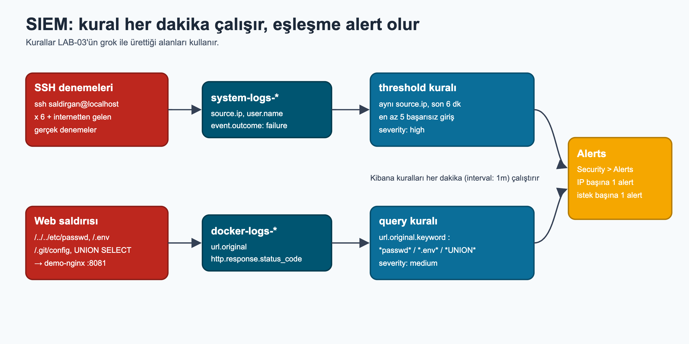
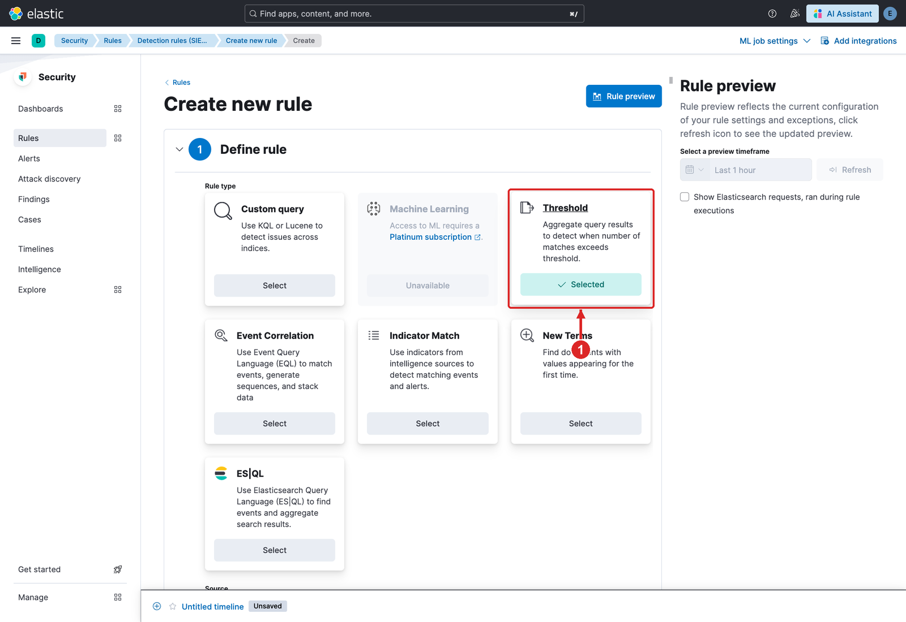
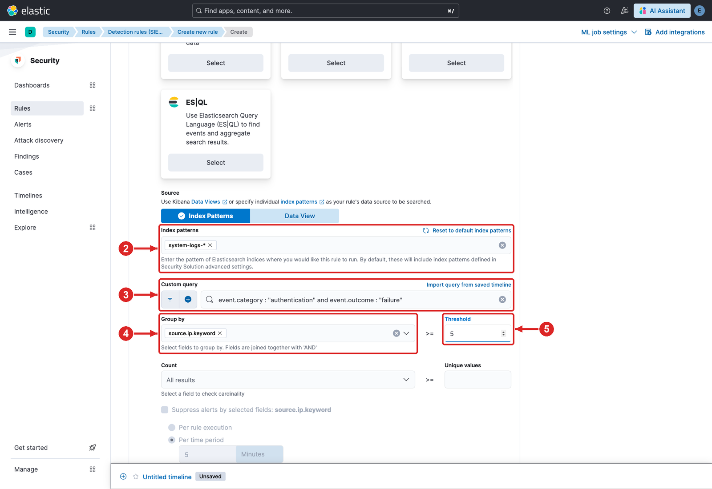
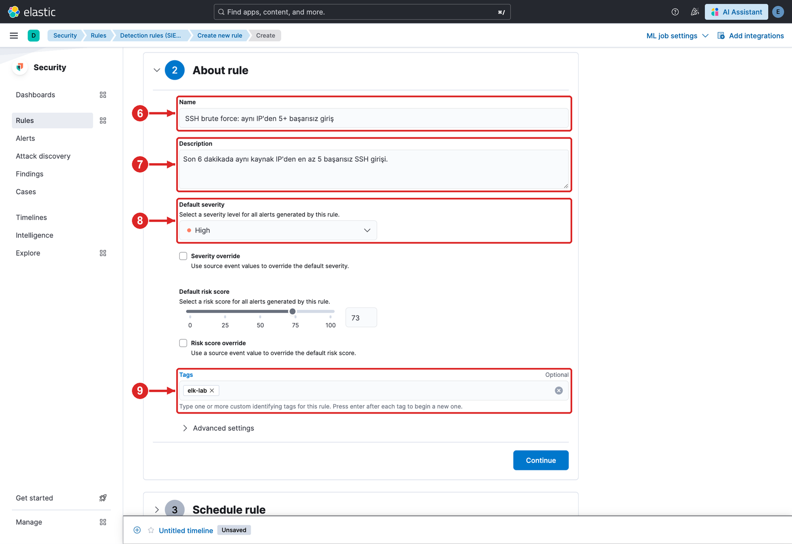
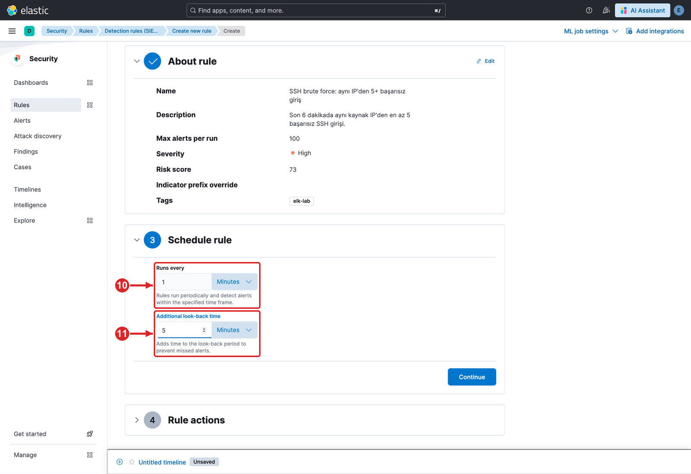
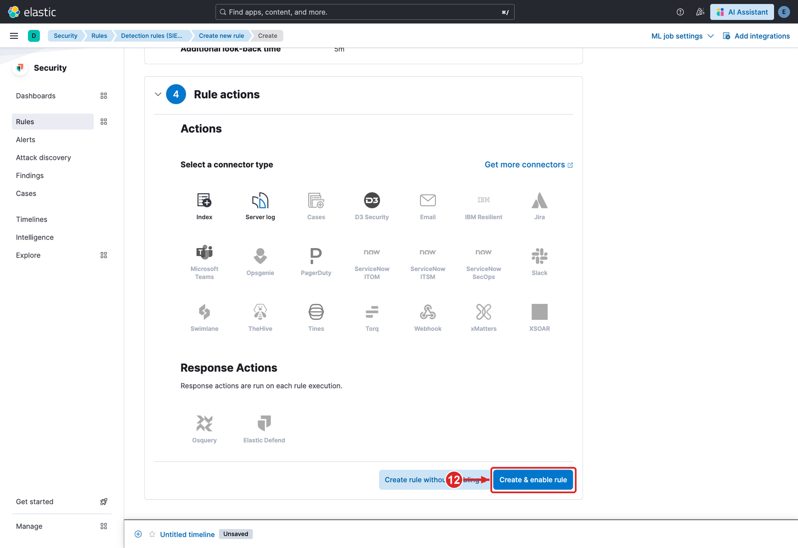
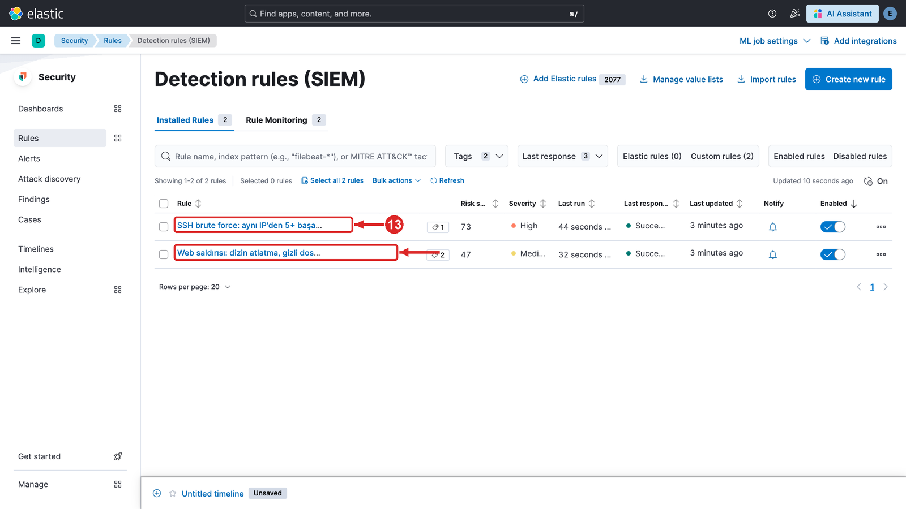
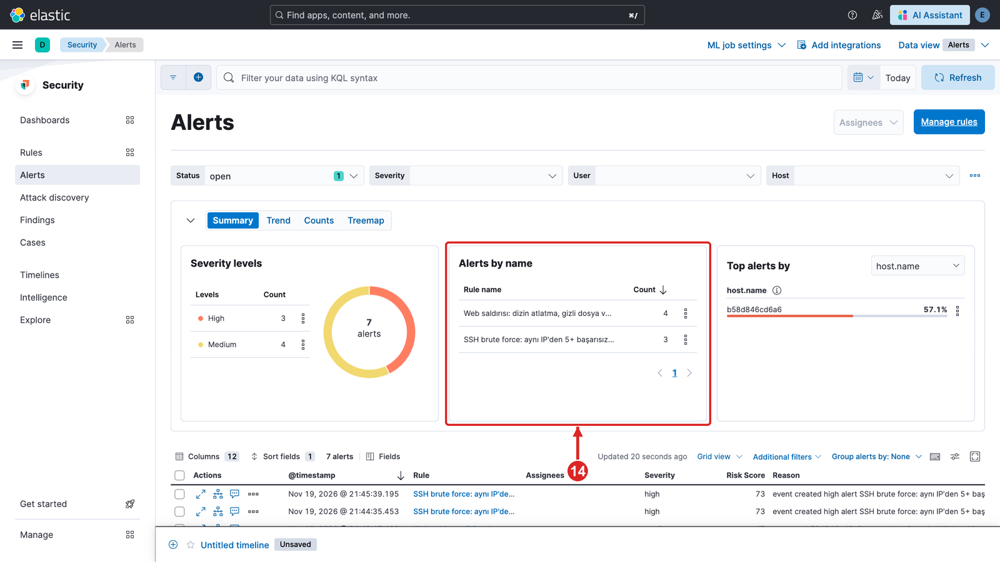

# LAB-ELK-06 — SIEM: Detection Rule ve Alert

| Profil / Araçlar | Açık Portlar |
|---|---|
| Kibana Security (Detection rules), `curl` | 15601 (Kibana), 8081 (demo Nginx) |

## Amaç

- SSH brute force ve web saldırısı için iki detection rule kurmak.
- Sunucuya gerçek başarısız SSH girişleri ve saldırı istekleri göndermek.
- Kuralların ürettiği alert'leri Kibana Security ekranında görmek.

## Ön Koşullar

- LAB-ELK-01 stack'i, LAB-ELK-03 Filebeat'i ve LAB-ELK-04'ün Nginx'i ile grok filtresi çalışıyor olmalıdır.
- Kurallar LAB-04'ün ürettiği alanları kullanır: `event.outcome`, `source.ip`, `url.original`.

## Mimari ve Çalışma Modeli

{width=60%}

Detection rule, Kibana'nın belirli aralıkla (burada her dakika) çalıştırdığı kayıtlı bir sorgudur. Sorgu eşleşirse bir **alert** belgesi yazılır ve Security > Alerts ekranında görünür.

| Kural | Tür | Ne zaman alert üretir |
|---|---|---|
| `rules/ssh-bruteforce.json` | `threshold` | Son 6 dakikada aynı `source.ip`'den en az 5 başarısız SSH girişi (`event.category: authentication`, `event.outcome: failure`) |
| `rules/web-attack.json` | `query` | `demo-nginx` logunda URL'de `passwd`, `.env`, `.git` veya `UNION` geçen her istek |

<details>
<summary><strong>Kural dosyasındaki alanlar</strong></summary>

| Alan | Ne işe yarar |
|---|---|
| `index` | Kuralın arayacağı index'ler. |
| `query` | KQL sorgusu; Discover'da da aynısını deneyebilirsiniz. |
| `threshold.field`, `threshold.value` | Gruplama alanı ve eşik. `source.ip.keyword` IP başına sayar. |
| `interval`, `from` | Kural her dakika çalışır ve son 6 dakikaya bakar. |
| `severity`, `risk_score` | Alert listesinde önem sırası. |

</details>

## Adım Adım Uygulama Rehberi

### 1. SSH kuralını arayüzden kurma

Kibana menüsünden **Security > Rules > Detection rules (SIEM)**'e gidin ve sağ üstteki **Create new rule**'a tıklayın.

**Define rule:**

1. Rule type olarak **Threshold**'u (1) seçin. Threshold kuralı, sorguya uyan belgeleri bir alana göre gruplar ve bir grubun sayısı eşiği geçerse alert üretir. Brute force tam olarak budur: aynı IP'den kısa sürede çok sayıda başarısız giriş.

   {width=75%}

2. **Index patterns** (2): kuralın hangi index'lerde arayacağı. Varsayılan desenler Elastic Agent index'leri içindir; sağdaki ⓧ ile silin, `system-logs-*` yazıp Enter'a basın.
3. **Custom query** (3): hangi belgelerin sayılacağı. Yalnız başarısız kimlik doğrulama satırları: `event.category : "authentication" and event.outcome : "failure"`
4. **Group by** (4): sayımın hangi alana göre ayrılacağı. `source.ip.keyword` yazıp listeden seçin; her IP ayrı sayılır.
5. **Threshold** (5): `5`. Bir IP'nin sayısı 5'e ulaşınca alert üretilir. Sonra **Continue**'ya tıklayın.

   {width=75%}

**About rule:**

6. **Name** (6): `SSH brute force: aynı IP'den 5+ başarısız giriş`
7. **Description** (7): `Son 6 dakikada aynı kaynak IP'den en az 5 başarısız SSH girişi.`
8. **Default severity** (8): **High**. Alert listesinde önem sırasını ve rengini belirler; risk skoru da buna göre 73 olur.
9. **Tags** (9): `elk-lab` yazıp Enter'a basın. Etiket, kuralları listede filtrelemeye ve temizlikte bu labın kurallarını tek komutla silmeye yarar. Sonra **Continue**.

   {width=75%}

**Schedule rule:**

10. **Runs every** (10): `1` Minutes
11. **Additional look-back time** (11): `5` Minutes. Kural her dakika çalışır ve son 6 dakikaya bakar. Sonra **Continue**.

   {width=75%}

**Rule actions:**

12. **Rule actions** alert oluşunca e-posta, Slack gibi bildirim göndermek içindir; bu labda alert'leri Kibana'da göreceğiz. Bildirim eklemeden **Create & enable rule**'a (12) tıklayın; kural hemen çalışmaya başlar.

   {width=75%}

<details>
<summary><strong>Aynı kuralı API ile kurmak</strong></summary>

Arayüzde girdiğiniz değerlerin JSON hâli `rules/ssh-bruteforce.json` dosyasındadır. Kuralı arayüzde kurduysanız bunu çalıştırmayın; aynı kuralın ikinci kopyası oluşur.

```text
curl -s -u elastic:'DevOps2026!' -X POST "http://localhost:15601/api/detection_engine/rules" \
  -H "kbn-xsrf: true" -H "Content-Type: application/json" -d @rules/ssh-bruteforce.json
```

</details>

### 2. Web kuralını API ile kurma

İkinci kuralı dosyadan, Kibana Detection Engine API'siyle kurun. Arayüzde doldurduğunuz alanların aynısı JSON dosyasında yazılıdır (`type: query`, `index`, `query`, `severity`, `interval`). Çok sayıda kuralı aynı anda kurmak ya da kuralları Git'te saklamak için bu yol kullanılır. `kbn-xsrf` başlığı, Kibana API'sinin değişiklik yapan isteklerde zorunlu tuttuğu bir güvenlik başlığıdır:

```bash
cd ~/elk-lab/06-siem-detection
curl -s -u elastic:'DevOps2026!' -X POST "http://localhost:15601/api/detection_engine/rules" \
  -H "kbn-xsrf: true" -H "Content-Type: application/json" -d @rules/web-attack.json | jq -c '{name, type, enabled}'
```

```text
{"name":"Web saldırısı: dizin atlatma, gizli dosya veya SQL injection","type":"query","enabled":true}
```

**Detection rules (SIEM)** listesinde iki kural da görünür (13):

{width=75%}

### 3. SSH brute force

Var olmayan `saldirgan` kullanıcısıyla 6 kez SSH girişi deneyin. Eşik 5 olduğu için 6 deneme kuralı tetikler. Döngü, 6 satırın da Elasticsearch'e düşmesini bekler ve sayıyı gösterir:

```bash
for i in 1 2 3 4 5 6; do
  ssh -o BatchMode=yes -o StrictHostKeyChecking=no -o UserKnownHostsFile=/dev/null -o LogLevel=ERROR saldirgan@localhost true 2>/dev/null
done
until curl -s -u elastic:'DevOps2026!' "http://localhost:9200/system-logs-*/_count?q=user.name:saldirgan" | jq -e '.count >= 6' > /dev/null; do sleep 5; done
curl -s -u elastic:'DevOps2026!' "http://localhost:9200/system-logs-*/_count?q=user.name:saldirgan%20AND%20event.outcome:failure" | jq .count
```

```text
6
```

### 4. Web saldırısı

Demo Nginx'e saldırgan tarayıcılarının sık denediği dört istek gönderin:

- `/../../../../etc/passwd`: dizin atlatma; sunucudaki parola dosyasını okumaya çalışır.
- `/.env`, `/.git/config`: yanlışlıkla yayına açık kalmış gizli ayar dosyalarını arar.
- `?id=1 UNION SELECT password`: SQL injection; veritabanından parola çekmeye çalışır.

`--path-as-is`, `curl`'ün `../` kısmını silmeden göndermesini sağlar. Nginx bu istekleri reddeder (400/404), ama her biri erişim loguna yazılır ve kural bunları yakalar:

```bash
for p in "/../../../../etc/passwd" "/.env" "/.git/config" "/urunler?id=1%20UNION%20SELECT%20password"; do
  curl -s --path-as-is -o /dev/null -w "%{http_code} $p\n" "http://localhost:8081$p"
done
```

```text
400 /../../../../etc/passwd
404 /.env
404 /.git/config
404 /urunler?id=1%20UNION%20SELECT%20password
```

### 5. Alert'leri görme

Kurallar dakikada bir çalışır. Olaylardan sonra her kuralın en az bir kez çalışması için iki dakika bekleyip alert'leri kural adına göre sayın. Alert'ler `.alerts-security.alerts-default` index'ine yazılır; sorgu bu index'te kural adına göre gruplama yapar:

```bash
sleep 120
curl -s -u elastic:'DevOps2026!' -X POST "http://localhost:15601/api/detection_engine/signals/search" \
  -H "kbn-xsrf: true" -H "Content-Type: application/json" \
  -d '{"size": 0, "aggs": {"kural": {"terms": {"field": "kibana.alert.rule.name"}}}}' | jq -c '.aggregations.kural.buckets[]'
```

```text
{"key":"Web saldırısı: dizin atlatma, gizli dosya veya SQL injection","doc_count":4}
{"key":"SSH brute force: aynı IP'den 5+ başarısız giriş","doc_count":2}
```

Web kuralı her istek için bir alert üretir (4). SSH kuralı aynı IP'deki denemeleri tek alert'te toplar; ama dakikada bir son 6 dakikaya baktığı için aynı denemeler sonraki çalışmada yeniden sayılabilir ve sayı 1'den büyük olabilir. Sunucunuza internetten gelen denemeler de alert sayısını artırır.

SSH alert'inin hangi IP'den kaç deneme saydığını görün:

```bash
curl -s -u elastic:'DevOps2026!' -X POST "http://localhost:15601/api/detection_engine/signals/search" \
  -H "kbn-xsrf: true" -H "Content-Type: application/json" \
  -d '{"size": 5, "query": {"exists": {"field": "kibana.alert.threshold_result.count"}}, "_source": ["kibana.alert.threshold_result"]}' \
  | jq -c '.hits.hits[]._source["kibana.alert.threshold_result"] | {ip: .terms[0].value, deneme: .count}' | sort -u
```

```text
{"ip":"127.0.0.1","deneme":6}
```

Kibana'da **Security > Alerts**'u açın. **Alerts by name** (14) iki kuralı ve alert sayılarını gösterir; alttaki listeden bir alert'e tıklayınca ayrıntısı açılır.

{width=75%}

## Temizlik

`elk-lab` etiketli iki kuralı silin; LAB-04'ün Nginx'ini ve grok filtresini kapatın:

```bash
curl -s -u elastic:'DevOps2026!' -X POST "http://localhost:15601/api/detection_engine/rules/_bulk_action" \
  -H "kbn-xsrf: true" -H "Content-Type: application/json" \
  -d '{"action": "delete", "query": "alert.attributes.tags:\"elk-lab\""}' | jq -c '.attributes.summary'
cd ~/elk-lab/04-logstash-grok && docker compose down
rm -f ~/elk-lab/01-elk-stack-setup/pipeline/50-grok.conf
```

```text
{"failed":0,"succeeded":2,"skipped":0,"total":2}
```

Üretilmiş alert'ler `.alerts-security.alerts-default` index'inde kalır; LAB-01 temizliği hepsini siler.

Sonraki lab: **[LAB-ELK-07 — Cluster Sağlığı, Disk Kilidi ve ILM](../07-cluster-health-ilm/README.md)**
