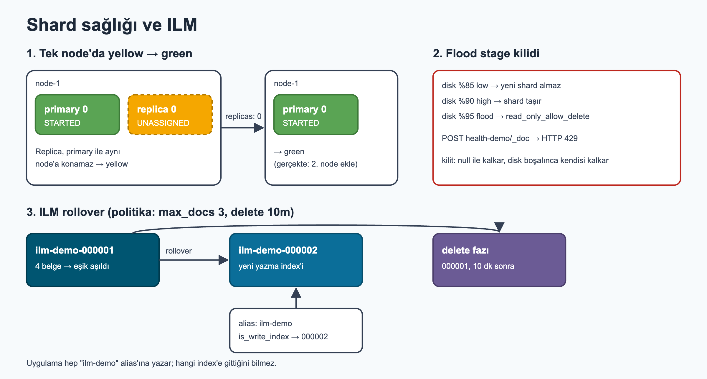
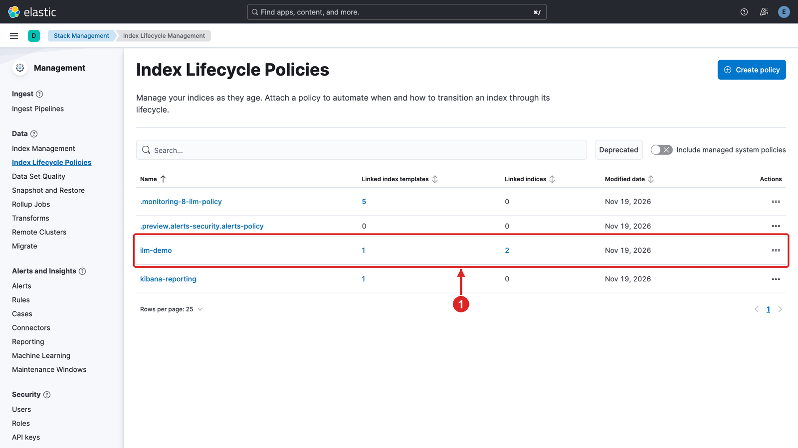
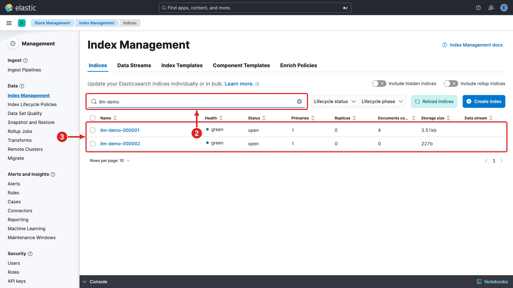

# LAB-ELK-07 — Cluster Sağlığı, Disk Kilidi ve ILM

| Profil / Araçlar | Açık Portlar |
|---|---|
| Elasticsearch 8.19 API, `curl`, `jq` | 9200 (Elasticsearch) |

## Amaç

- Cluster'ın neden `yellow` olduğunu bulup `green` yapmak.
- Disk doluluğunda gelen yazma kilidini (HTTP 429) görmek ve açmak.
- ILM ile index'in kendiliğinden yenisine geçmesini (rollover) izlemek.

## Ön Koşullar

- LAB-ELK-01 stack'i çalışıyor olmalıdır. Önceki lablarda oluşan `*-logs-*` index'leri varsa onlar da kullanılır.

## Mimari ve Çalışma Modeli

{width=60%}

| Durum | Anlamı |
|---|---|
| `green` | Bütün primary ve replica shard'lar atanmış. |
| `yellow` | Primary'ler atanmış, en az bir replica atanamamış. Veri tam, ama yedek yok. |
| `red` | En az bir primary atanamamış; o index'in bir kısmına erişilemez. |

Elasticsearch replica'yı primary ile aynı node'a koymaz. Tek node'lu cluster'da `number_of_replicas: 1` olan her index bu yüzden `yellow` kalır.

Disk dolulukta üç eşik vardır: %85 (low) yeni shard almaz, %90 (high) shard taşır, %95 (flood stage) index'lere `read_only_allow_delete` kilidi koyar ve yazma `429` ile reddedilir. Bu labda diski doldurmadan aynı kilidi tek bir index'e elle koyarak sonucunu göreceğiz.

ILM (Index Lifecycle Management), index'in yaşam döngüsünü politikayla yönetir: `hot` fazında belirli boyut, yaş veya belge sayısında yeni index'e geçer (rollover), `delete` fazında eski index'i siler.

## Adım Adım Uygulama Rehberi

### 1. Yellow cluster'ı bulma

```bash
curl -s -u elastic:'DevOps2026!' "http://localhost:9200/_cluster/health?filter_path=status,number_of_nodes,unassigned_shards" | jq -c .
```

Durumu kendi index'inizde görmek için replica'sı 1 olan bir test index'i oluşturun ve shard'larına bakın. `_cat/shards` her shard'ın türünü ve durumunu tablo olarak verir:

```bash
curl -s -u elastic:'DevOps2026!' -X PUT "http://localhost:9200/health-demo" \
  -H "Content-Type: application/json" -d '{"settings": {"number_of_replicas": 1}}' | jq -c .
curl -s -u elastic:'DevOps2026!' "http://localhost:9200/_cat/shards/health-demo?v&h=index,shard,prirep,state,unassigned.reason"
```

```text
index       shard prirep state      unassigned.reason
health-demo 0     p      STARTED    
health-demo 0     r      UNASSIGNED INDEX_CREATED
```

`p` primary (asıl), `r` replica (yedek). Replica `UNASSIGNED`. `_cluster/allocation/explain` API'si, bir shard'ın neden atanamadığını her node için ayrı ayrı açıklar; atanmamış shard'larda ilk bakılacak yer burasıdır:

```bash
curl -s -u elastic:'DevOps2026!' -X POST "http://localhost:9200/_cluster/allocation/explain?filter_path=current_state,node_allocation_decisions.deciders.explanation" \
  -H "Content-Type: application/json" -d '{"index": "health-demo", "shard": 0, "primary": false}' | jq -c .
```

Cevaptaki açıklama, replica'nın aynı shard'ın kopyasını taşıyan node'a konamayacağını söyler.

### 2. Green yapma

Tek node'da replica'yı 0 yapın:

```bash
curl -s -u elastic:'DevOps2026!' -X PUT "http://localhost:9200/health-demo/_settings" \
  -H "Content-Type: application/json" -d '{"index": {"number_of_replicas": 0}}' | jq -c .
curl -s -u elastic:'DevOps2026!' "http://localhost:9200/_cat/indices/health-demo?h=health,index,rep"
```

```text
green health-demo 0
```

Lab index'leri her gün yeni adla açılır (`system-logs-2026.11.20` gibi). Yeni index'lerin de replica'sız açılması için bir **index template** ekleyin. Template, adı belirli bir desene uyan her yeni index'e baştan uygulanacak ayarları tutar; Logstash ertesi gün `system-logs-2026.11.20`'yi açtığında bu ayarlar otomatik gelir:

```bash
curl -s -u elastic:'DevOps2026!' -X PUT "http://localhost:9200/_index_template/elk-lab-logs" \
  -H "Content-Type: application/json" \
  -d '{"index_patterns": ["system-logs-*", "docker-logs-*", "k8s-logs-*", "other-logs-*"], "template": {"settings": {"number_of_replicas": 0}}}' | jq -c .
```

```text
{"acknowledged":true}
```

Şu an yellow olan bütün index'leri listeleyin. Kibana'nın kendi oluşturduğu, adı `.` ile başlayan index'ler de listede olabilir:

```bash
curl -s -u elastic:'DevOps2026!' "http://localhost:9200/_cat/indices?health=yellow&expand_wildcards=all&h=index,rep"
```

```text
.ds-.items-default-2026.11.19-000001 1
k8s-logs-2026.11.19                  1
system-logs-2026.11.19               1
docker-logs-2026.11.19               1
.ds-.lists-default-2026.11.19-000001 1
```

Hepsinin replica'sını 0 yapın ve cluster'ı tekrar kontrol edin:

```bash
for i in $(curl -s -u elastic:'DevOps2026!' "http://localhost:9200/_cat/indices?health=yellow&expand_wildcards=all&h=index"); do
  echo -n "$i "
  curl -s -u elastic:'DevOps2026!' -X PUT "http://localhost:9200/$i/_settings" \
    -H "Content-Type: application/json" -d '{"index": {"number_of_replicas": 0}}'
  echo
done
curl -s -u elastic:'DevOps2026!' "http://localhost:9200/_cluster/health?filter_path=status,unassigned_shards" | jq -c .
```

```text
.ds-.items-default-2026.11.19-000001 {"acknowledged":true}
k8s-logs-2026.11.19 {"acknowledged":true}
system-logs-2026.11.19 {"acknowledged":true}
docker-logs-2026.11.19 {"acknowledged":true}
.ds-.lists-default-2026.11.19-000001 {"acknowledged":true}
{"status":"green","unassigned_shards":0}
```

Gerçek bir cluster'da doğru çözüm replica'yı kapatmak değil, ikinci node eklemektir.

### 3. Flood-stage kilidi

Diskin ne kadar dolu olduğuna bakın:

```bash
curl -s -u elastic:'DevOps2026!' "http://localhost:9200/_cat/allocation?v&h=node,disk.percent,disk.used,disk.avail"
```

```text
node         disk.percent disk.used disk.avail
9dde2eb03bf5           64    61.9gb     33.9gb
```

Disk %95'e ulaşınca Elasticsearch'in koyduğu kilidi `health-demo` index'ine elle koyun ve yazmayı deneyin:

```bash
curl -s -u elastic:'DevOps2026!' -X PUT "http://localhost:9200/health-demo/_settings" \
  -H "Content-Type: application/json" -d '{"index.blocks.read_only_allow_delete": true}' | jq -c .
curl -s -u elastic:'DevOps2026!' -o /dev/null -w "HTTP %{http_code}\n" -X POST "http://localhost:9200/health-demo/_doc" \
  -H "Content-Type: application/json" -d '{"msg": "test"}'
curl -s -u elastic:'DevOps2026!' -X POST "http://localhost:9200/health-demo/_doc" \
  -H "Content-Type: application/json" -d '{"msg": "test"}' | jq -r .error.reason | cut -c1-120
```

```text
{"acknowledged":true}
HTTP 429
index [health-demo] blocked by: [TOO_MANY_REQUESTS/12/disk usage exceeded flood-stage watermark, index has read-only-al
```

Disk boşaldığında Elasticsearch kilidi kendisi kaldırır. Elle kaldırmak için:

```bash
curl -s -u elastic:'DevOps2026!' -X PUT "http://localhost:9200/health-demo/_settings" \
  -H "Content-Type: application/json" -d '{"index.blocks.read_only_allow_delete": null}' | jq -c .
curl -s -u elastic:'DevOps2026!' -X POST "http://localhost:9200/health-demo/_doc" \
  -H "Content-Type: application/json" -d '{"msg": "test"}' | jq -r .result
```

```text
{"acknowledged":true}
created
```

### 4. ILM ile rollover

ILM varsayılan olarak 10 dakikada bir kontrol eder. Lab için 10 saniyeye indirin:

```bash
curl -s -u elastic:'DevOps2026!' -X PUT "http://localhost:9200/_cluster/settings" \
  -H "Content-Type: application/json" -d '{"persistent": {"indices.lifecycle.poll_interval": "10s"}}' | jq -c .acknowledged
```

Politika: 3 belgeyi geçince yeni index'e geç, 10 dakika sonra eskisini sil. Gerçekte bu değerler `max_primary_shard_size: 50gb`, `max_age: 1d`, `min_age: 30d` gibidir:

```bash
curl -s -u elastic:'DevOps2026!' -X PUT "http://localhost:9200/_ilm/policy/ilm-demo" \
  -H "Content-Type: application/json" \
  -d '{"policy": {"phases": {"hot": {"actions": {"rollover": {"max_docs": 3}}}, "delete": {"min_age": "10m", "actions": {"delete": {}}}}}}' | jq -c .
```

Rollover için iki parça gerekir:

- **Alias:** index'e verilen ikinci ad. Uygulama gerçek index adını (`ilm-demo-000001`) değil, alias'ı (`ilm-demo`) kullanır. `is_write_index: true`, yazmaların alias altındaki hangi index'e gideceğini belirler.
- **Template:** `ilm-demo-*` adıyla açılan her index'e politikayı (`index.lifecycle.name`) ve alias adını (`index.lifecycle.rollover_alias`) bağlar; ILM'in açacağı `000002` de bu ayarlarla açılır.

Template'i ekleyin ve ilk index'i alias ile açın:

```bash
curl -s -u elastic:'DevOps2026!' -X PUT "http://localhost:9200/_index_template/ilm-demo" \
  -H "Content-Type: application/json" \
  -d '{"index_patterns": ["ilm-demo-*"], "template": {"settings": {"number_of_replicas": 0, "index.lifecycle.name": "ilm-demo", "index.lifecycle.rollover_alias": "ilm-demo"}}}' | jq -c .
curl -s -u elastic:'DevOps2026!' -X PUT "http://localhost:9200/ilm-demo-000001" \
  -H "Content-Type: application/json" -d '{"aliases": {"ilm-demo": {"is_write_index": true}}}' | jq -c .
```

Alias'a 4 belge yazın ve ILM'in kontrol etmesini bekleyin:

```bash
for i in 1 2 3 4; do
  curl -s -u elastic:'DevOps2026!' -X POST "http://localhost:9200/ilm-demo/_doc" \
    -H "Content-Type: application/json" -d "{\"n\": $i}" > /dev/null
done
sleep 40
curl -s -u elastic:'DevOps2026!' "http://localhost:9200/_cat/indices/ilm-demo-*?v&h=index,docs.count&s=index"
curl -s -u elastic:'DevOps2026!' "http://localhost:9200/_cat/aliases/ilm-demo?v&h=alias,index,is_write_index"
```

```text
index           docs.count
ilm-demo-000001          4
ilm-demo-000002          0
alias    index           is_write_index
ilm-demo ilm-demo-000001 false
ilm-demo ilm-demo-000002 true
```

ILM `ilm-demo-000002`'yi açtı ve yazma alias'ını ona taşıdı; uygulama hep `ilm-demo` adına yazar, hangi index'e gittiğini bilmez. `000001` 10 dakika sonra silinir.

```bash
curl -s -u elastic:'DevOps2026!' "http://localhost:9200/ilm-demo-*/_ilm/explain?filter_path=indices.*.phase,indices.*.action" | jq -c .
```

Aynı durumu Kibana'da görün:

1. Menüden **Management > Stack Management > Index Lifecycle Policies**'e gidin. **ilm-demo** (1) satırında **Linked indices** sütunu `2` gösterir; politikaya tıklayınca hot ve delete fazlarını görürsünüz.

   {width=75%}

2. **Stack Management > Index Management > Indices**'e geçin ve arama kutusuna (2) `ilm-demo` yazın. İki index (3) ve belge sayıları listelenir; adına tıklayınca index'in hangi ILM fazında olduğu görünür.

   {width=75%}

<details>
<summary><strong>JVM heap için iki kural</strong></summary>

- Heap (`-Xms` ve `-Xmx`, aynı değer) sunucu RAM'inin en çok yarısı olmalı; kalan RAM işletim sisteminin dosya önbelleğine kalır ve Lucene aramalarını hızlandırır.
- Heap 31 GB'ı geçmemeli. 32 GB'ın üstünde JVM sıkıştırılmış işaretçileri (compressed oops) kapatır ve aynı veri daha çok bellek tutar.

Bu labın heap'i `docker-compose.yml`'deki `ES_JAVA_OPTS` ile 1 GB'tır:

```bash
curl -s -u elastic:'DevOps2026!' "http://localhost:9200/_cat/nodes?v&h=name,heap.max,heap.percent,ram.max"
```

</details>

## Temizlik

Bu labın index'lerini, template'lerini, politikasını ve ayarını kaldırın:

```bash
curl -s -u elastic:'DevOps2026!' -X DELETE "http://localhost:9200/health-demo" | jq -c .
INDICES=$(curl -s -u elastic:'DevOps2026!' "http://localhost:9200/_cat/indices/ilm-demo-*?h=index" | tr -d ' ' | paste -sd, -)
[ -n "$INDICES" ] && curl -s -u elastic:'DevOps2026!' -X DELETE "http://localhost:9200/$INDICES" | jq -c .
curl -s -u elastic:'DevOps2026!' -X DELETE "http://localhost:9200/_index_template/ilm-demo" | jq -c .
curl -s -u elastic:'DevOps2026!' -X DELETE "http://localhost:9200/_ilm/policy/ilm-demo" | jq -c .
curl -s -u elastic:'DevOps2026!' -X PUT "http://localhost:9200/_cluster/settings" \
  -H "Content-Type: application/json" -d '{"persistent": {"indices.lifecycle.poll_interval": null}}' | jq -c .acknowledged
```

`elk-lab-logs` template'i kalabilir; lab index'lerinin replica'sız açılmasını sağlar.

Bütün lablar bittiyse ortamı tamamen kaldırmak için [kök README'deki temizlik adımlarına](../README.md#temizlik) bakın.
