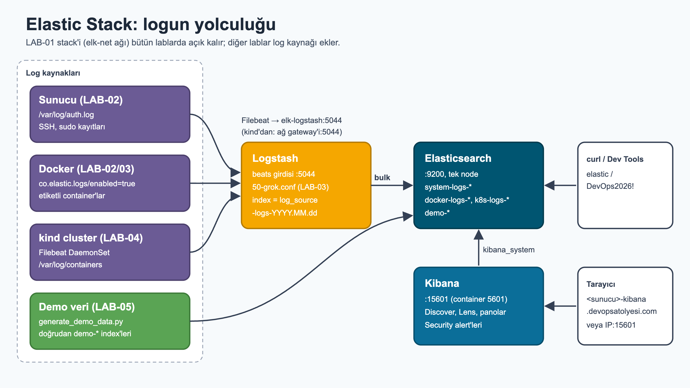

# Elastic Stack (ELK 8.19) Lab Serisi

Elasticsearch, Logstash, Kibana ve Filebeat ile sunucu, Docker ve Kubernetes loglarını toplayıp ayrıştırma, arama, pano ve SIEM kuralı.

{width=60%}

## Lablar

Lablar sırayla yapılır; LAB-01'de kurulan stack bütün lablarda açık kalır.

| Lab | Konu | Portlar |
|---|---|---|
| [LAB-ELK-01](01-elk-stack-setup/README.md) | Elastic Stack kurulumu, belge ekleme/arama, Dev Tools | 9200, 15601, 5044 |
| [LAB-ELK-02](02-filebeat-host-docker/README.md) | Filebeat ile Linux (`auth.log`) ve Docker logları | — |
| [LAB-ELK-03](03-logstash-grok/README.md) | Logstash grok ile Nginx ve SSH satırlarını alanlara ayırma | 8081 |
| [LAB-ELK-04](04-kubernetes-logs/README.md) | kind cluster'da Filebeat DaemonSet, çok satırlı hata yığını | — |
| [LAB-ELK-05](05-kibana-dashboards/README.md) | Hazır panolar, data view, Discover/KQL, Lens | 15601 |
| [LAB-ELK-06](06-siem-detection/README.md) | SSH brute force ve web saldırısı için detection rule ve alert | 15601, 8081 |
| [LAB-ELK-07](07-cluster-health-ilm/README.md) | Yellow/green cluster, flood-stage kilidi, ILM rollover | 9200 |

## Başlangıç

Repoyu sunucunun ev dizinine indirin; README'lerdeki komutlar `~/elk-lab` yolunu kullanır:

```bash
git clone https://gitlab.com/devops-practitioner-labs/elk-lab.git ~/elk-lab
```

| Bilgi | Değer |
|---|---|
| Elasticsearch | `http://localhost:9200` |
| Kibana | `echo "https://$(hostname)-kibana.devopsatolyesi.com"` veya `http://<sunucu-IP>:15601` |
| Kullanıcı / parola | `elastic` / `DevOps2026!` (değiştirmek için `01-elk-stack-setup/.env.example` dosyasını `.env` olarak kopyalayın) |
| Sürüm | Elasticsearch, Kibana, Logstash, Filebeat `8.19.25` |
| Bellek | Elasticsearch 1 GB, Logstash 512 MB heap; LAB-04'ün kind cluster'ı ek ~1 GB |

## Temizlik

Bütün lablar bittiğinde, her labın kendi temizliğinden sonra stack'i kaldırın:

```bash
cd ~/elk-lab/02-filebeat-host-docker && docker compose down -v
cd ~/elk-lab/03-logstash-grok && docker compose down
rm -f ~/elk-lab/01-elk-stack-setup/pipeline/50-grok.conf
kind delete cluster --name elk-lab --kubeconfig ~/.kube/elk-lab 2>/dev/null; rm -f ~/.kube/elk-lab
cd ~/elk-lab/01-elk-stack-setup && docker compose down -v
```

Bu komutlar yalnız bu serinin container'larını, volume'larını ve `elk-lab` kind cluster'ını siler; sunucudaki diğer container'lara ve cluster'lara dokunmaz.
